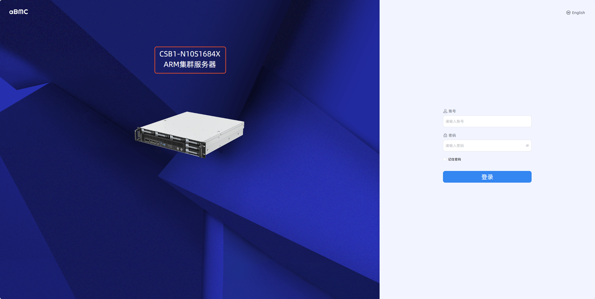
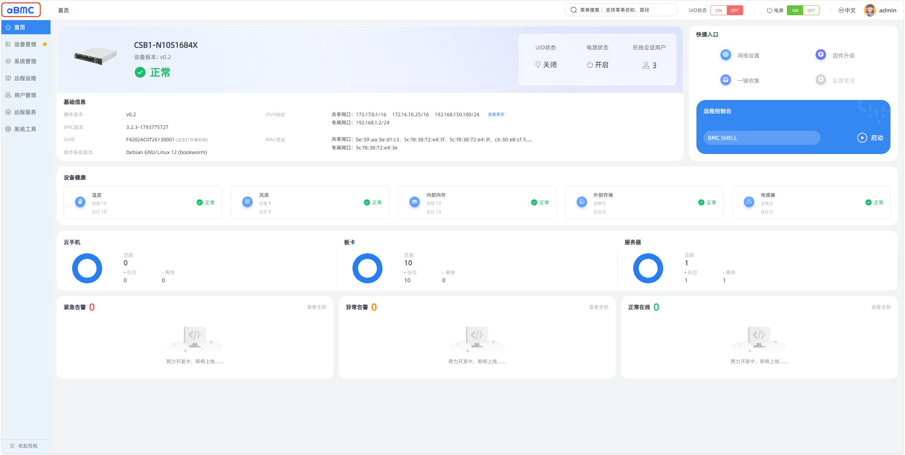

# Page Customization Guide

This guide describes how to customize the product information and icons on the aBMC login page and management page.

## Introduction

Page customization requires modifying files on the server's BMC management device. The directory path is `/etc/aBMC/cus`. The files in this directory are described as follows:

- `config.json`: configures the product name and product type.
- `loginLogo.svg`: configures the logo icon on the login page.
- `product.svg`: configures the product icon on both the login page and the management page.
- `headerLogo.svg`: configures the logo icon on the management page.

<Callout title="Note" type="info">
    Files mentioned in the following steps all refer to files with the same name under `/etc/aBMC/cus/` on the BMC management device. After modifying any of these files, run `sudo systemctl restart aBMC` to restart the service.
</Callout>

## Login Page Customization

### Customizing the product name and type [step]

1. Edit `config.json` to modify the `productName` and `productType` fields: the former is the product name, and the latter is the product type.
2. Restart the aBMC service.
3. Refresh the login page and check whether the area in the red box in the figure below has changed. The upper line of text is the product name, and the lower line is the product type.

### Customizing the logo icon [step]

1. Upload an SVG file to overwrite `loginLogo.svg`.
2. Restart the aBMC service.
3. Refresh the login page and check whether the area in the red box in the figure below has changed.

### Customizing the product icon [step]

1. Upload an SVG file to overwrite `product.svg`.
2. Restart the aBMC service.
3. Refresh the login page and check whether the area in the red box in the figure below has changed.

## Management Page Customization

### Customizing the product name [step]

1. Edit `config.json` to modify the `productName` field.
2. Restart the aBMC service.
3. Refresh the management page and check whether the area in the red box in the figure below has changed.

### Customizing the logo icon [step]

1. Upload an SVG file to overwrite `headerLogo.svg`.
2. Restart the aBMC service.
3. Refresh the management page and check whether the area in the red box in the figure below has changed.

### Customizing the product icon [step]

1. Upload an SVG file to overwrite `product.svg`.
2. Restart the aBMC service.
3. Refresh the management page and check whether the area in the red box in the figure below has changed.

