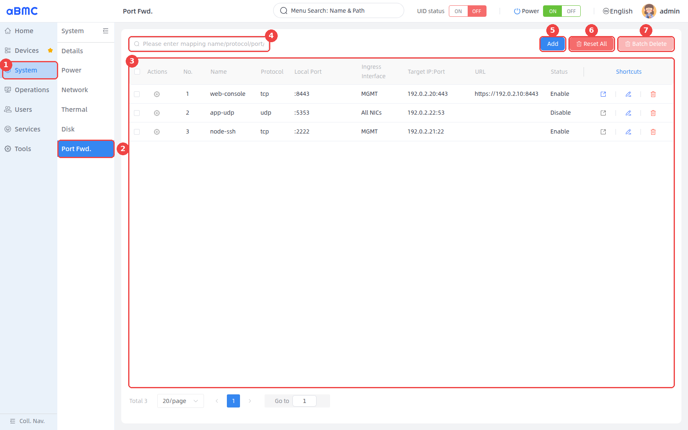
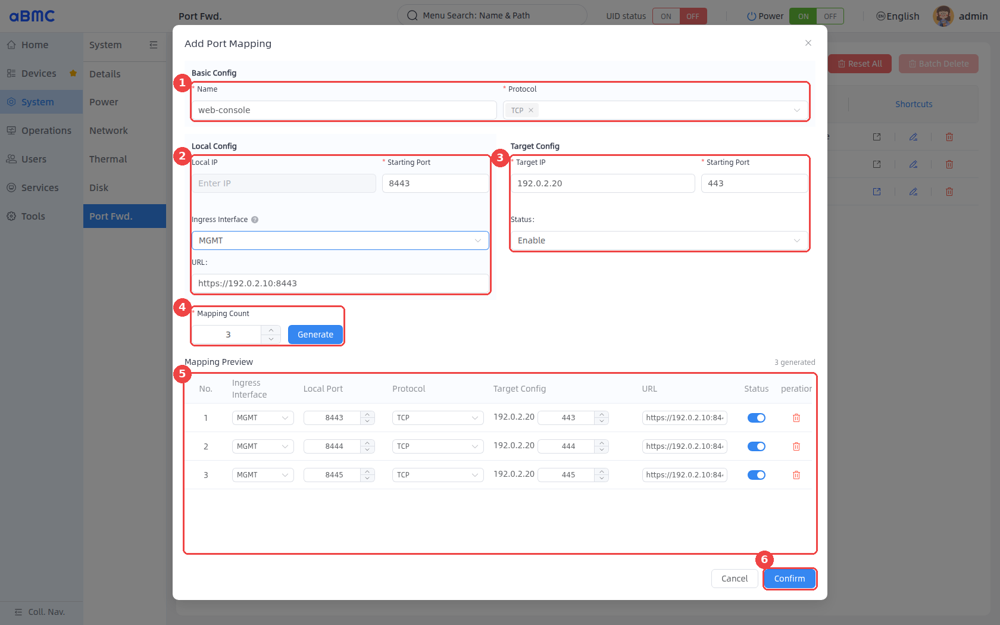
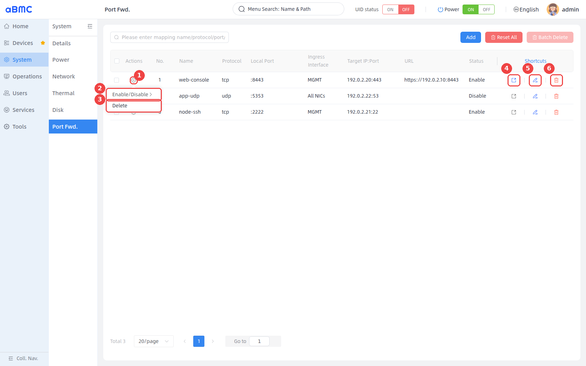
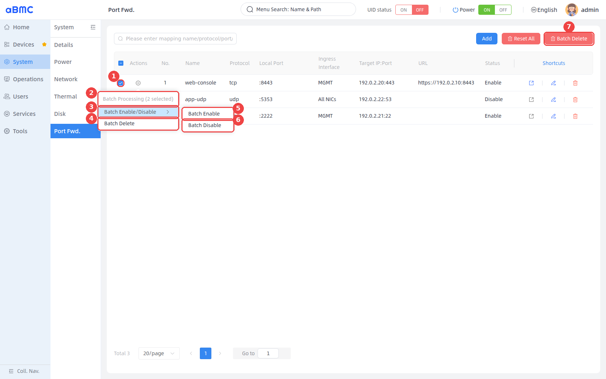

# Port Forwarding

## Introduction

Port Forwarding is a traffic forwarding management feature designed for array servers. It consists of two major modules: rule management and page redirection:

1. Rule management: provides unified creation, enabling, disabling, editing, and deletion of forwarding rules.

2. Page redirection: supports one-click access to the management web pages of array sub-nodes that customers deploy inside the server, enabling quick access

<Callout title="Version Requirement" type="info">
    aBMC version >= v3.2.4
</Callout>

## Development Vision
1. Provide users with a unified network entry point to simplify operations and maintenance and reduce the cost of managing array sub-node addresses, routing, and access entries.

2. Users can use rule management to apply fine-grained control over traffic, effectively avoiding unnecessary port exposure within array sub-nodes.

# Using the Feature

## Viewing Port Forwarding

<CodeBlockTabs defaultValue="WEB">
  <CodeBlockTabsList>
    <CodeBlockTabsTrigger value="WEB">WEB</CodeBlockTabsTrigger>
    <CodeBlockTabsTrigger value="API">API</CodeBlockTabsTrigger>
  </CodeBlockTabsList>

  <CodeBlockTab value="WEB">
    ### Open the Port Forwarding Page [step]

    1. Select **System** in the left main navigation.
    2. Select **Port Fwd.** in the secondary navigation bar.
    3. Wait for the rule list and pagination area to finish loading, then view the current rules; when there are no rules, the list displays **No Data**.
    4. To find a rule, enter a mapping name, protocol, port, IP, status, or URL in the search box.
    5. To create a rule, click **Add**.
    6. To delete rules in bulk, select the target rules and click **Batch Delete**.
    7. To remove all rules, click **Reset All**.

    

    ### List Field Description [step]

    | Field | Description |
    | --- | --- |
    | Actions | Opens the rule action menu. When multiple rules are selected, the menu provides batch enable, batch disable, and batch delete. |
    | No. | The sequence number of the rule on the current page. |
    | Name | The mapping name, used to identify the forwarding service or usage scenario. |
    | Protocol | The transport layer protocol used for forwarding; the value is tcp or udp. |
    | Local Port | The local port on which the BMC listens externally, displayed as `:port`. The management host accesses the mapped service through this port. |
    | Ingress Interface | The ingress interface on which the rule takes effect. Only traffic entering from this interface is forwarded; when not specified, the value is **All NICs**. |
    | Target IP:Port | The destination IPv4 address and service port to which traffic is ultimately forwarded. |
    | URL | The quick access address configured for the Web service. |
    | Status | The rule is currently **Enable** or **Disable**. |
    | Shortcuts | Provides quick icons for opening the URL, editing the rule, and deleting the rule; the open icon is unavailable when no URL is configured. |

    <Callout title="Access Path" type="info">
      The forwarding path is: management host → `BMC_IP:Local Port` → `Target IP:Target Port`. The URL is only used for quick access from the page and does not replace the actual target IP and target port configuration.
    </Callout>

    <Callout title="Disable vs. Delete" type="warn">
      **Disable** only stops forwarding and keeps the configuration; **Delete**, **Batch Delete**, and **Reset All** all remove rules, and the related port forwarding becomes invalid immediately. **Reset All** deletes every rule on the device.
    </Callout>
  </CodeBlockTab>

  <CodeBlockTab value="API">
    | Operation | Method | URI |
    | --- | --- | --- |
    | View the port mapping list | GET | `/redfish/v1/Systems/bmc/Oem/Firefly/PortMappings` |

    <Callout title="Note" type="info">
      For details about interface authentication, request parameters, response fields, and error codes, see the Redfish API documentation.
    </Callout>
  </CodeBlockTab>
</CodeBlockTabs>

## Adding Port Forwarding Rules

<CodeBlockTabs defaultValue="WEB">
  <CodeBlockTabsList>
    <CodeBlockTabsTrigger value="WEB">WEB</CodeBlockTabsTrigger>
    <CodeBlockTabsTrigger value="API">API</CodeBlockTabsTrigger>
  </CodeBlockTabsList>

  <CodeBlockTab value="WEB">
    ### Plan the Network [step]

    Before adding a rule, confirm the forwarding protocol, the local listening port on the BMC, the ingress interface, the target device address, the target service port, and the initial status of the rule. The local port must not conflict with BMC system services or other mapping rules, and the target service must be reachable from the network where the BMC resides.

    ### Fill In the Basic Configuration [step]

    On the port forwarding page, click **Add** to open the **Add Port Mapping** dialog, then configure it as shown below:

    1. Enter **Name** in **Basic Config**.
    2. Select **Protocol**, either TCP or UDP; the default is TCP.
    3. Enter the **Starting Port** that the BMC listens on externally in **Local Config**. **Local IP** is assigned by the system and cannot be edited on the page.
    4. Select **Ingress Interface**, that is, the interface on which the rule takes effect. You can select **All NICs** or a specific NIC; the tooltip states that only traffic entering from this interface is mapped, that leaving it empty applies to all interfaces, and that the management port is MGMT.
    5. To provide a Web shortcut, enter a complete access address in **URL**.
    6. Enter **Target IP** and **Starting Port** in **Target Config**, and set **Status** to **Enable** or **Disable**.

    

    ### Generate the Mapping Preview [step]

    1. Enter the number of rules to generate as a positive integer in **Mapping Count**.
    2. Click **Generate**; the system generates consecutive mappings starting from the starting port and lists them in **Mapping Preview**.
    3. Check **Ingress Interface**, **Local Port**, **Protocol**, **Target Config**, **URL**, and **Status** row by row, and modify a row directly if adjustment is needed.
    4. To remove a single mapping, click the delete icon on the right of that row.
    5. When the preview is empty, the list displays **Complete the form and generate mappings**.

    ### Save the Rules [step]

    1. Verify that the rules in the preview list match the network plan.
    2. Click **Confirm** to save. **Confirm** is unavailable until mappings are generated.
    3. After a successful save, the page displays **Generated N port mappings**, and the rules appear in the list.

    ### Parameter Description [step]

    | Parameter | Required | Description | Requirement |
    | --- | --- | --- | --- |
    | Name | Yes | The mapping name. | 1 to 32 characters; Chinese, English letters, numbers, underscores, and hyphens are supported. |
    | Protocol | Yes | The protocol used for port forwarding. | TCP or UDP; the default is TCP and it must match the target service. |
    | Local IP | System-assigned | The local listening address of the BMC. | Read-only on the page; no manual input required. |
    | Starting Port | Yes | The starting local port that the BMC listens on externally. | An integer in the range `1–65535` that is not used by system services or other rules. |
    | Ingress Interface | Yes | The ingress interface on which the rule takes effect. | Select **All NICs** or a specific NIC; leaving it empty is equivalent to **All NICs**, and the management port is **MGMT**. |
    | URL | No | The shortcut address used by the open icon in **Shortcuts**. | For Web services, enter a complete URL including protocol, address, and port; it can be left empty for non-Web services. |
    | Target IP | Yes | The target device address that receives the forwarded traffic. | A valid IPv4 address reachable from the BMC. |
    | Starting Port | Yes | The starting service port on the target device. | An integer in the range `1–65535`; make sure the target service is listening on that port. |
    | Status | Yes | The status of the rule after saving. | **Enable** means the rule is active after saving; **Disable** means the configuration is saved but not forwarded. |
    | Mapping Count | Yes | The number of rules generated in this batch. | A positive integer greater than or equal to `1`; the starting port plus the count minus one must not exceed `65535`. |

    ### Consecutive Port Generation [step]

    The system generates multiple rules starting from the entered starting port according to **Mapping Count**, increasing both the local port and the target port. For example, when **Starting Port** is `8443`, the target **Starting Port** is `443`, and **Mapping Count** is `3`:

    | No. | Ingress Interface | Local Port | Protocol | Target Config | Description |
    | --- | --- | --- | --- | --- | --- |
    | 1 | MGMT | `8443` | TCP | `192.0.2.20:443` | The first mapping |
    | 2 | MGMT | `8444` | TCP | `192.0.2.20:444` | The second mapping |
    | 3 | MGMT | `8445` | TCP | `192.0.2.20:445` | The third mapping |

    <Callout title="About the Example Addresses" type="info">
      `192.0.2.0/24` is the example address range used in this document. Replace it with the BMC address, target device address, and ports available on site; do not use the example values directly.
    </Callout>

    ### Validation Messages [step]

    | Message | Cause and Handling |
    | --- | --- |
    | Format error. Only Chinese, English letters, numbers, underscores, and hyphens are supported, with a length of 1-32 characters. | The name does not meet the naming requirement; adjust its length or characters. |
    | Port must be in the range of 1-65535 | The local or target starting port is out of range; use an integer between `1` and `65535`. |
    | Please enter a valid target IP address | The target IP format is invalid; enter a valid IPv4 address. |
    | Local ports TCP 3333 already exist. Change the starting port or count. | The local port is already in use; change the starting port or reduce the count. |
    | Generated ports cannot exceed 65535 | The generated ports exceed `65535`; reduce **Mapping Count** or lower the starting port. |

    ### Verify the Configuration [step]

    1. Return to the rule list and verify that **Name**, **Protocol**, **Local Port**, **Ingress Interface**, and **Target IP:Port** match the network plan.
    2. Verify that **Status** is as expected; when it is **Enable**, connect to `BMC_IP:Local Port` from a management host allowed to access the BMC.
    3. Verify that requests reach the target service, and check the target device's service status, listening port, firewall, and routing.
    4. When a URL is configured, click the open icon in **Shortcuts** to verify that the shortcut address is accessible.

    <Callout title="Security Note" type="warn">
      Enabling port forwarding adds a new network entry point for the target service. Map only the services required by the business, and restrict access sources through the ingress interface and on-site network policies. Do not keep management ports that are not needed for external access enabled for long periods.
    </Callout>
  </CodeBlockTab>

  <CodeBlockTab value="API">
    | Operation | Method | URI |
    | --- | --- | --- |
    | Query the action parameters | GET | `/redfish/v1/Systems/bmc/Oem/Firefly/PortMappings/Actions/ConfigureActionInfo` |
    | Set port mappings | POST | `/redfish/v1/Systems/bmc/Oem/Firefly/PortMappings/Actions/Configure` |

    <Callout title="Note" type="info">
      The **Configure** action submits rules through the `PortMappings` array. Each element contains fields such as `service_name`, `protocol`, `external_port`, `internal_ip`, `internal_port`, `external_ifname`, `status`, and `RedirectUrl`, and multiple rules can be submitted at once. For details about interface authentication, request parameters, response fields, and error codes, see the Redfish API documentation.
    </Callout>
  </CodeBlockTab>
</CodeBlockTabs>

## Managing Port Forwarding Rules

<CodeBlockTabs defaultValue="WEB">
  <CodeBlockTabsList>
    <CodeBlockTabsTrigger value="WEB">WEB</CodeBlockTabsTrigger>
  </CodeBlockTabsList>

  <CodeBlockTab value="WEB">
    ### Rule Management Entries [step]

    When rules exist in the list, choose the corresponding action as shown below:

    1. Click the gear icon in the **Actions** column of the target rule to open the action menu.
    2. Select **Enable/Disable** to enable or disable the rule.
    3. Select **Delete** to delete the current rule.
    4. In **Shortcuts**, click the open icon to access the URL configured for the rule.
    5. Click the edit icon to modify the current rule.
    6. Click the delete icon to delete the current rule quickly.

    

    ### Enable or Disable a Rule [step]

    1. Open the action menu in **Actions** of the target rule.
    2. Select **Enable/Disable**, then select **Enable** or **Disable**.
    3. Return to the list and verify that **Status** has been updated.
    4. After enabling the rule, verify the forwarding entry; after disabling it, verify that the local port no longer forwards traffic.

    ### Edit a Rule [step]

    1. Click the edit icon in **Shortcuts** of the target rule to open the **Edit Port Forward** dialog.
    2. The dialog edits one rule at a time; you can modify the name, protocol, local port, ingress interface, target address, URL, or status.
    3. After clicking **Confirm**, recheck the list content and verify the forwarding result.

    <Callout title="Changing the Local Port" type="warn">
      Changing Local Port changes the access entry of the management host. Before saving, verify that the new port is not in use, and update the access addresses, scripts, and maintenance records that depend on the entry.
    </Callout>

    ### Open the Shortcut Address [step]

    1. Verify that a URL has been configured for the target rule.
    2. Click the open icon in **Shortcuts**.
    3. When the URL is empty, the open icon is unavailable; use the corresponding protocol client and `BMC_IP:Local Port` for non-Web services such as SSH and databases.

    ### Delete a Rule [step]

    1. Verify that no business or maintenance personnel are using the forwarding entry.
    2. Select **Delete** in the **Actions** menu, or click the delete icon in **Shortcuts**.
    3. In the **Alert** dialog, read the message, confirm that the related port forwarding becomes invalid immediately after deletion, then click **Confirm**.
    4. Return to the list, verify that the rule has been removed, and confirm that the local port no longer forwards traffic.

    ### Batch Management [step]

    1. Select at least two rules using the checkboxes on the left of the list.
    2. Open the **Actions** menu of any selected rule; the top of the menu shows the number of selected rules, for example **Batch Processing (2 selected)**.
    3. Select **Batch Enable/Disable** to expand **Batch Enable** and **Batch Disable**.
    4. Select **Batch Enable** to enable all selected rules, or **Batch Disable** to disable all selected rules.
    5. Select **Batch Delete**, or click **Batch Delete** in the toolbar, to delete all selected rules.

    

    <Callout title="Scope of Batch Operations" type="warn">
      Batch operations affect all currently selected rules. Before executing, verify the count and scope displayed on the page; afterwards, check the status of each rule or confirm that the rules have been removed.
    </Callout>

    ### Remove All Rules [step]

    1. Verify that none of the port forwarding rules on the device are still needed.
    2. Click **Reset All** in the toolbar.
    3. In the **Alert** dialog, read the message and click **Confirm**; all rules are deleted.
    4. Return to the list and verify that it displays **No Data**.

    <Callout title="Temporarily Stopping a Rule" type="info">
      To stop forwarding only temporarily, use **Disable** to keep the configuration; delete the rule only when the entry is no longer needed. **Reset All** deletes every rule, so use it with care.
    </Callout>
  </CodeBlockTab>
</CodeBlockTabs>

## FAQ

### 1. The List Shows No Data

No port forwarding rules have been configured on the device. Click **Add** to create a rule; if a rule was just configured but the list is still empty, refresh the page and verify that the save operation succeeded.

### 2. The Local Port Is Unavailable

The port may already be used by a BMC system service or another port forwarding rule. If **Local ports TCP xxxx already exist** appears when you click **Generate**, change **Starting Port** or reduce **Mapping Count**, and update the corresponding access addresses and maintenance configuration.

### 3. Fewer Mappings Are Generated Than Entered

When consecutive ports are generated according to **Mapping Count**, the starting port plus the count minus one may exceed `65535`; the page then displays **Generated ports cannot exceed 65535**. Reduce the count or lower the starting port and generate again.

### 4. The URL Fails to Open but Forwarding Works

The URL shortcut and the actual forwarding parameters are independent. Verify the protocol, address, and port in the URL; for non-Web services, use the corresponding protocol client to connect to `BMC_IP:Local Port`.

### 5. The Rule Is Not Needed Temporarily but Will Be Used Later

Set the rule to **Disable** to keep the original configuration, and re-enable it when needed instead of deleting and recreating it.