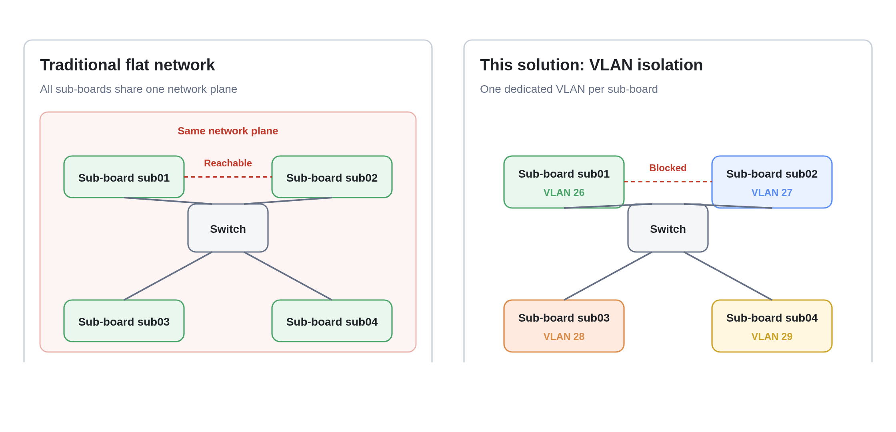

# Network Isolation Case

## Overview

This case describes how to use the VLAN features of the server's internal switch to implement Layer 2 network isolation between sub-boards (compute core boards): the sub-boards are invisible to each other and cannot communicate directly, while each sub-board can still access the external network and be managed by the BMC.

## Intended Audience

- **Network administrators**: plan the VLAN ID, switch port, and IP address for each sub-board.
- **Operations staff for multi-tenant or R&D/test environments**: need sub-boards to be invisible to and independent of each other.
- **Security and compliance owners**: need to prevent lateral attacks and fault propagation caused by direct sub-board communication.

## Application Scenario

A server usually contains multiple sub-boards. By default, all sub-boards are on the same network plane and any sub-board can directly access the others. If one sub-board is compromised or generates abnormal traffic, the risk can spread across the entire cluster.

| Scenario | Do sub-boards need to communicate? | Does this case apply? |
| --- | --- | --- |
| Multi-tenant / compute rental | No | Yes |
| R&D / test cluster | Isolate by project | Yes |
| Single-service deployment | Yes | No; keep the default network |

## How It Works

### VLAN plan

| VLAN | Purpose |
| --- | --- |
| VLAN 2–49 | One dedicated VLAN per sub-board, used to isolate sub-boards from each other |
| VLAN 50 | External network (sub-board Internet access and BMC external communication) |
| VLAN 4000 | Management communication between the BMC and the switch |

Each sub-board has a unique VLAN ID. For example, sub3-01 uses 26 and sub3-02 uses 27. The mapping between VLAN IDs and switch ports must be prepared according to the actual device.

### Port configuration

| Port | Configuration (example) | Purpose |
| --- | --- | --- |
| External ports `xe1/49–xe1/52` | `default 50 utag 2-49` | Remove the VLAN tag when sub-board traffic leaves for the external network |
| BMC port `xe1/54` | `default 50 utag 2-49 tag 4000` | The BMC accesses the external network through VLAN 50 and keeps the VLAN 4000 management tag |
| Sub-board port (for example `ge1/33`) | `default <sub-board VLAN> utag 50` | Put sub-board traffic into its dedicated VLAN; remove the VLAN 50 tag on traffic sent back to the sub-board |



*Figure: Traditional flat network (left) vs VLAN isolation (right). After isolation, each sub-board belongs to its own VLAN; the external ports remove sub-board VLAN tags, and the BMC port keeps the management VLAN tag.*

### Data flow

Take sub3-01 as an example:

1. Traffic from sub3-01 enters `ge1/33` and is tagged with **VLAN 26**.
2. When the traffic goes to the external network, it leaves through an external port; the VLAN 2–49 tag is removed and the frame is sent as a normal Ethernet frame.
3. Return traffic from the external network enters through the external port and is placed in **VLAN 50**; the tag is removed when the traffic is sent to sub3-01 through `ge1/33`.
4. sub3-02 uses **VLAN 27**, which is a separate Layer 2 network from VLAN 26, so the two sub-boards cannot receive each other's traffic.

## Procedure

Plan first, then configure the switch, and finally configure the sub-boards. This avoids the intermediate state where VLANs exist but ports are not configured.

### Step 1: Plan sub-boards, ports, and VLANs [step]

Determine the following for each sub-board according to the actual "sub-board to switch port" mapping:

| Item | Example | Notes |
| --- | --- | --- |
| Sub-board | sub3-01 | Based on the actual device |
| Switch port | `ge1/33` | Based on the actual device |
| Dedicated VLAN | 26 | 2–49, unique per sub-board |
| Sub-board IP | 172.16.11.87 | Example only; plan it for the site |

### Step 2: Create VLANs on the switch [step]

Log in to the switch web UI and create and enable the following VLANs:

| VLAN | Purpose |
| --- | --- |
| 50 | External network |
| 4000 | Management between the BMC and the switch |
| 2–49 | One per sub-board (create as many as needed) |

### Step 3: Configure the external ports [step]

Set `xe1/49`, `xe1/50`, `xe1/51`, and `xe1/52` to **Hybrid** mode with the following parameters:

```text
default 50 utag 2-49
```

- `default 50`: traffic entering from the external network is placed in VLAN 50.
- `utag 2-49`: remove the VLAN tag when sub-board traffic leaves through these ports so that the external network can recognize it.

### Step 4: Configure the BMC port [step]

Set `xe1/54`, the port used by the BMC, to **Hybrid** mode with the following parameters:

```text
default 50 utag 2-49 tag 4000
```

- `default 50`: the BMC accesses the external network through VLAN 50.
- `utag 2-49`: remove the VLAN tag when communicating with sub-boards.
- `tag 4000`: keep the VLAN 4000 tag for management communication between the BMC and the switch.

After the configuration, run `ping 172.16.0.1` on the BMC. A successful ping to the external gateway indicates that the BMC network is configured correctly.

### Step 5: Configure the sub-board ports [step]

Set the port for each sub-board to **Hybrid** mode with the following parameters:

```text
default <VLAN ID of the sub-board> utag 50
```

Examples:

| Sub-board | Switch port | Configuration |
| --- | --- | --- |
| sub3-01 | `ge1/33` | `default 26 utag 50` |
| sub3-02 | `ge1/29` | `default 27 utag 50` |

### Step 6: Verify isolation [step]

| Test | Procedure | Expected result |
| --- | --- | --- |
| Sub-board external access | Run `ping 172.16.0.1` on sub3-01 and sub3-02 | Ping succeeds |
| BMC to sub-board | Run `ping -I nic0_5G 172.16.11.87` and `ping -I nic0_5G 172.16.10.44` on the BMC | Ping succeeds |
| Sub-board isolation | Ping sub3-02's IP from sub3-01, then the reverse | **Ping fails (expected)** |

<Callout title="Note" type="warn">
  Sub-boards being unable to ping each other is the design goal, not a fault. The port numbers, VLAN IDs, and IP addresses in this document are examples; adjust them according to the actual device and site network plan.
</Callout>