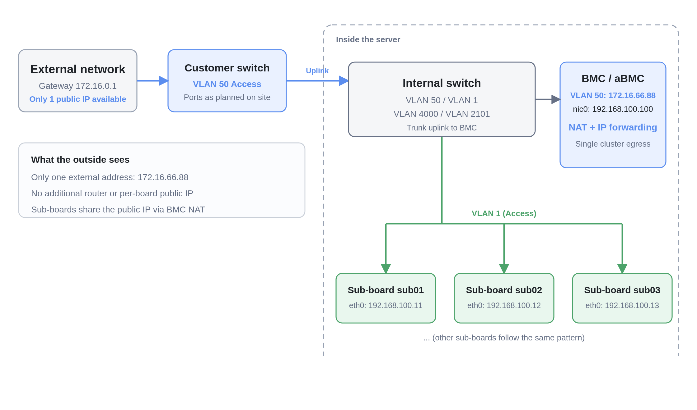
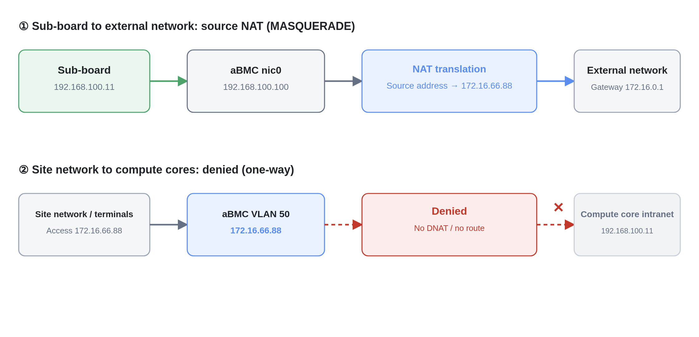

# Network Sharing Case

## Overview

When deploying array servers at scale, the site network environment is often not known during project planning. It is only during deployment that constraints such as a limited public IP quota, strict network control, and a ban on configuring multiple public IPs become apparent.

The traditional architecture uses a one-to-one "one core board, one public IP" model: every core board needs its own public IP, either requested separately or configured manually. This model only works for small deployments. For large array clusters it causes IP shortages, non-compliant multi-IP deployment, high O&M costs, and wasted addresses. Adding a router increases hardware and maintenance costs and requires multi-department coordination, budget approval, and procurement, which significantly extends the deployment cycle.

This case uses a high-speed BMC NIC (5 Gbps or higher recommended) with the internal L3 switch to create WAN and LAN logical interfaces through VLANs, and enables NAT and IP forwarding on the BMC so that the whole cluster uses only one public IP. The goal is to reduce public IP consumption, simplify O&M, improve address utilization, and isolate the internal and external networks without adding network devices.

## Intended Audience

- **Network administrators and delivery engineers**: the site has a limited public IP quota or forbids bulk configuration of multiple public IPs.
- **Operations staff**: want to reduce the work of configuring IP addresses for each sub-board and the associated maintenance cost.
- **Project owners**: need to deploy the cluster without major changes to the site network.

## Application Scenario

As the number of cluster nodes grows, the limitations of the one-to-one IP model become obvious:

| Site problem | Details | How this case addresses it |
| --- | --- | --- |
| High cost and long approval cycle for new network devices | A router adds hardware and maintenance costs; a temporary device also requires multi-department coordination, budget approval, and procurement | No additional router; reuse the BMC's NAT and IP forwarding |
| Public IP shortage | A `/24` subnet has only 254 usable addresses, while two 128-node servers already have 256 nodes | The whole cluster uses only one public IP |
| Complex network O&M | IP addresses must be configured, recorded, maintained, and troubleshot one by one; bulk changes easily cause IP conflicts, parameter errors, and inconsistent records | Sub-boards use internal addresses; only the BMC needs a public address |
| Low public IP utilization | Most core boards only perform routine data exchange but each holds a public IP | Internal addresses do not consume public IPs; the public address is shared |

This case applies to clusters with a limited public IP quota, a ban on multiple public IPs, or a requirement to avoid adding a router. If public IPs are sufficient, assign an independent IP to each sub-board and do not enable this case.

## How It Works

### WAN / LAN split

The high-speed BMC NIC works with the internal L3 switch to create two logical interfaces through VLANs:

| Logical interface | VLAN (example) | Connects to | Purpose |
| --- | --- | --- | --- |
| WAN | VLAN 50 | Site service network | Single external egress for the cluster |
| LAN | VLAN 1 | Compute cores (sub-boards) | Carry compute core data traffic |
| Management | VLAN 2101 / 4000 | aBMC, switch | Internal management and device communication |

The L3 switch puts the compute nodes and the site service network into two independent network zones, providing internal/external isolation.

### One-way communication

This case requires **one-way communication**: compute cores can access site terminals such as cameras, but the site network cannot directly access the compute core intranet.

| Direction | Allowed? | Implementation |
| --- | --- | --- |
| Compute core → site terminal | Yes | MASQUERADE (source NAT) on the BMC |
| Site network → compute core intranet | No | No DNAT; internal addresses are not advertised, and VLAN isolation plus routing policy block the traffic |



*Figure: The external network sees only one address; compute cores use internal addresses and share the public IP through BMC NAT.*



*Figure: Compute cores use MASQUERADE to reach the external network; no DNAT is configured for the site network to access the compute core intranet.*

### Data flow

**Compute core to site terminal:**

1. The sub-board sends traffic to the BMC nic0.
2. The BMC forwards the traffic to the WAN interface (VLAN 50) with IP forwarding enabled.
3. MASQUERADE changes the source address to the BMC WAN address.
4. The traffic leaves for the site service network with this single public address.

**Site network to compute core:**

1. A site terminal accesses the BMC WAN address.
2. No DNAT rule or route to the compute core intranet exists on the BMC.
3. The traffic cannot enter the compute core intranet.

## Procedure

Configure in the following order: switch VLANs → aBMC → sub-boards and routing → IP forwarding and NAT → verification.

### Step 1: Configure WAN / LAN VLANs on the switch [step]

Log in to the switch web UI:

1. Create VLAN 50 (WAN), VLAN 1 (LAN), and VLAN 2101 / 4000 for management.
2. Set the site service network ports (for example `ge1/25`, `ge1/26`, `xe1/27`, `xe1/28`) to **Access** and add them to VLAN 50.
3. Set the BMC uplink port (for example `ge1/21`) to **Trunk** and allow VLAN 50 and VLAN 4000.
4. Set the ports for BMC nic0 and each sub-board eth0 to **Access** and add them to VLAN 1 (examples: `ge1/1`, `ge1/12`–`ge1/20`; confirm the BMC nic0 port on the actual device).

### Step 2: Configure aBMC [step]

1. Log in to the aBMC web UI and open **VLAN Network Configuration**.
2. Add the WAN interface (VLAN 50):

    | Item | Value (example) |
    | --- | --- |
    | IP address | 172.16.66.88/16 |
    | Subnet mask | 255.255.0.0 (16 bits) |
    | Gateway | 172.16.0.1 |
    | Gateway priority | 100 |

3. Configure a service address on BMC nic0 (LAN): 192.168.100.100/24.
4. Run `ping 172.16.0.1` on aBMC; a successful ping indicates that the WAN interface is configured correctly.

### Step 3: Configure sub-boards and routing [step]

1. Configure a service address on each sub-board eth0:

    ```text
    IP address: 192.168.100.x/24 (unique per sub-board; do not use .100, which belongs to the BMC)
    ```

2. Configure the default route on each sub-board to point to the BMC LAN address:

    ```bash
    ip route add default via 192.168.100.100
    ```

3. Run `ping 192.168.100.100` on a sub-board; a successful ping to the BMC indicates that the LAN configuration is correct.

### Step 4: Enable IP forwarding and configure NAT [step]

Log in to the BMC:

```bash
# Enable IP forwarding
echo 1 > /proc/sys/net/ipv4/ip_forward

# Make it persistent
echo "net.ipv4.ip_forward = 1" >> /etc/sysctl.conf
sysctl -p

# If nftables is also in use, flush its rules first to avoid conflicts
nft flush ruleset

# Outbound only: source NAT for compute cores accessing the external network
iptables-legacy -t nat -A POSTROUTING -o vlan50 -j MASQUERADE

# Show the rules
iptables-legacy -t nat -L -n -v
```

No DNAT is configured in this case, so the site network cannot initiate access to the compute core intranet.

<Callout title="Tip" type="info">
  If the default FORWARD policy on the BMC is DROP, add a rule to allow LAN → WAN forwarding; otherwise, the sub-boards still cannot access the external network.
</Callout>

### Step 5: Verify one-way communication [step]

| Test | Procedure | Expected result |
| --- | --- | --- |
| Compute core to site network | Run `ping 172.16.0.1` on a sub-board | Ping succeeds |
| Compute core to the Internet | Run `ping www.baidu.com` on a sub-board | Ping succeeds (DNS must be configured on the sub-board) |
| Site network to compute core intranet | Ping a sub-board internal address (for example `192.168.100.11`) from a site network terminal | **Ping fails (expected)** |

<Callout title="Note" type="warn">
  The addresses, ports, and VLAN IDs in this document are examples; adjust them according to the site network. After a BMC reboot, the `iptables` rules and `ip_forward` setting are not restored automatically; configure persistence. If external access to sub-boards is really required, evaluate the security risk and configure DNAT separately instead of opening the entire intranet.
</Callout>