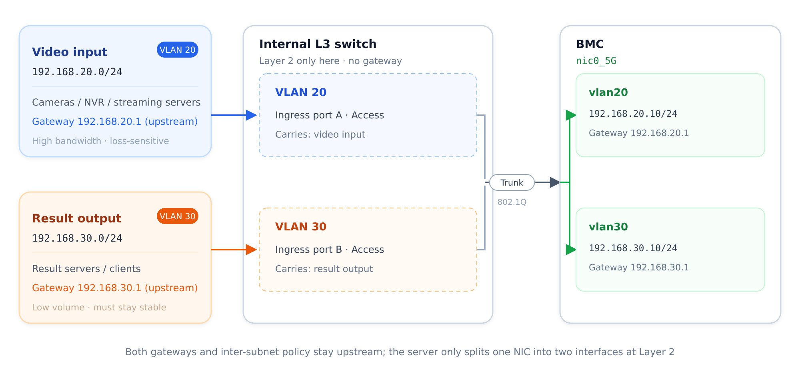

# Single NIC, Multiple Subnets Case

## Overview

This chapter describes how the server uses the VLAN features of its internal Layer 3 switch to make one physical NIC serve as two physical NICs.

## Intended Audience

This case is intended for:

- **Network administrators**: plan the VLAN IDs, subnets, and gateways, and permit the corresponding VLANs on the upstream devices.
- **Developers and test engineers who need to split subnets for services**: understand how "two interfaces on one NIC" is implemented and what its limits are.

## Application Scenario

The BMC has only one NIC, yet it has to provide access to two subnets at the same time. The differences in bandwidth and latency requirements between the two services mean that they must be carried separately:

| Service | Traffic direction | Traffic profile | Key concern | Subnet |
| --- | --- | --- | --- | --- |
| Video input | Cameras / NVRs / streaming servers → server | High bandwidth, continuous | Packet loss, jitter | 192.168.20.0/24 |
| Result output | Server → result servers / clients | Low volume, bursty | Stability, traceability | 192.168.30.0/24 |

If both services share one subnet, they interfere with each other and cannot be rate limited, measured, or troubleshot separately. Since no second NIC is available on the BMC, separating the subnets by adding hardware is not an option.

A workable approach is to reuse the existing network: both subnets are provided by the upstream devices and enter through other ports of the internal L3 switch, either through two upstream switches or through one trunk that carries both VLANs. The internal L3 switch only performs Layer 2 forwarding and delivers each subnet into its own VLAN; both gateways stay upstream, so no additional router is required.

## How It Works

A single NIC can carry two subnets because of Layer 2 isolation plus two sub-interfaces. No Layer 3 forwarding takes place on the server:

| Layer | Method | Effect |
| --- | --- | --- |
| Layer 2 | Switch ports are assigned to different broadcast domains by VLAN | The two subnets are invisible to each other inside the switch |
| Layer 2 | The port connected to `nic0_5G` is set as a trunk that permits both VLANs | One NIC sends and receives traffic for both subnets |
| Layer 2 | Two VLAN devices (sub-interfaces) are created on `nic0_5G` | The system sees two independent interfaces, each with one subnet address |
| Layer 3 | Gateways point to the upstream devices; no VLAN interface or routing is configured on the server | Outbound and inter-subnet access are handled by the upstream network |

Equivalent setup:

| Traditional multi-NIC approach (two subnets) | This approach (one NIC, two subnets) | Why they are equivalent |
| --- | --- | --- |
| NIC 1 + cable 1 + upstream port A ← subnet A | `vlan20` (VLAN Link = `nic0_5G`) + VLAN 20 tag | The tag separates broadcast domains, so neither subnet sees the other at Layer 2 |
| NIC 2 + cable 2 + upstream port B ← subnet B | `vlan30` (VLAN Link = `nic0_5G`) + VLAN 30 tag | As above; equivalent to a second physical network |
| Each subnet has its own upstream gateway | Each VLAN device uses the upstream gateway address | The gateway stays upstream; the server only separates traffic by VLAN |

The overall topology is shown below:



*Figure: the two subnets enter VLAN 20 and VLAN 30 through ingress ports A and B of the switch; the switch works at Layer 2 only and converges the VLANs onto a trunk; on the right, the single trunk on `nic0_5G` splits into `vlan20` and `vlan30`, and both gateways still point upstream.*

## Procedure

The VLAN IDs on the switch and on the BMC must match. Configure the switch first and the BMC second, so that you never end up in the intermediate state where a VLAN exists but the link does not work.

### Step 1: Internal L3 switch [step]

Open the aBMC management page and go to **Device Management** → **Switch Management Settings**, then configure the VLANs and ports as listed below.

| Item | Value | Purpose |
| --- | --- | --- |
| VLANs | Create VLAN 20 and VLAN 30 | Create two broadcast domains |
| Port connected to `nic0_5G` | **Trunk**, permitting VLAN 20 and VLAN 30 | Let one NIC carry both subnets |
| Ingress port of subnet 1 | Access, VLAN 20 | Deliver the video input subnet into VLAN 20 |
| Ingress port of subnet 2 | Access, VLAN 30 (same as above) | Deliver the result output subnet into VLAN 30 |

### Step 2: Create VLAN devices on the BMC [step]

Open **System → Network → VLAN Manage** in aBMC and add two VLAN devices on `nic0_5G`, one per subnet:

| VLAN device | VLAN ID | VLAN Link | IPv4 address | Gateway | Gateway priority |
| --- | --- | --- | --- | --- | --- |
| `vlan20` | 20 | `nic0_5G` | 192.168.20.10/24 | 192.168.20.1 | 100 |
| `vlan30` | 30 | `nic0_5G` | 192.168.30.10/24 | 192.168.30.1 | 200 |

Enter the address of the **upstream device** in that subnet as the gateway. The VLAN ID and the VLAN link cannot be changed after creation; delete and recreate the device if either is wrong. For field descriptions, screenshots, and the rules for creating, modifying, and deleting VLANs, see the "Managing BMC VLANs" section of the [aBMC Web User Manual](/docs/server/bmc-software/aBMC/bmcNetwork).

### Step 3: Verify connectivity [step]

From the BMC command line, ping the gateway of each subnet to verify that every VLAN device can reach its subnet:

```bash
ping -c 4 192.168.20.1   # gateway of vlan20
ping -c 4 192.168.30.1   # gateway of vlan30
```

| Interface | Gateway | Expected result |
| --- | --- | --- |
| `vlan20` | 192.168.20.1 | Replies received, 0% packet loss |
| `vlan30` | 192.168.30.1 | Replies received, 0% packet loss |

If both gateways respond, the VLAN segmentation, trunk configuration, and addressing are correct. If one subnet is unreachable, check the following in order:

1. Whether the VLAN exists on the switch and is permitted on the port connected to `nic0_5G`.
2. Whether the ingress port of that subnet is assigned to the correct VLAN.
3. Whether **VLAN Link** of the VLAN device is set to `nic0_5G`.
4. Whether the upstream gateway is online and in the same subnet as the VLAN device address.