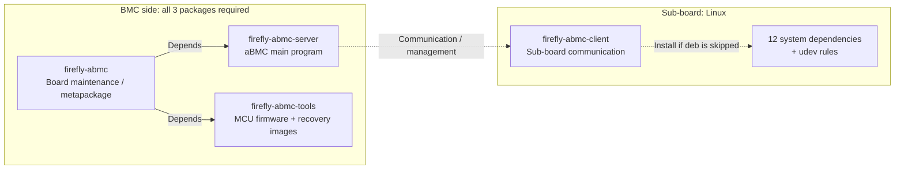

# Software Installation Guide

This guide describes how to download aBMC packages, the version directory structure, package relationships, and the installation and upgrade steps for the BMC and sub-boards.

## Download

The aBMC packages are shared through Baidu Netdisk. The shared directory is **aBMC**:

[Download link](https://pan.baidu.com/s/15kfthwxS8cbRJxC_tXggCA?pwd=jctu) (access code: `jctu`)

### Directory Structure

The aBMC directory is divided into subdirectories by version. Versions are ordered from newest to oldest, and the first one is the latest version.

```text
aBMC
├── v3.2.3
├── v3.2.0
├── v3.1.3
└── v2.9.4
```

Taking v3.2.3 as an example, the version directory contains the following files:

| File name | Installed on | Description |
| :--- | :--- | :--- |
| `firefly-abmc-server_3.2.3-1793180173_arm64.deb` | BMC | Server program: aBMC web management, node services, upgrade and recovery |
| `firefly-abmc-tools_1.1.0_arm64.deb` | BMC | Toolset: MCU firmware (fan control) + network recovery resources |
| `firefly-abmc_3.2.3-1793180173_all.deb` | BMC | Meta package / board maintenance services; installs the server and toolset automatically |
| `firefly-abmc-client_1.0.1_all.deb` | Sub-board | Runtime environment required for sub-board communication with aBMC; can be replaced by the 12 system dependencies + udev rules |
| `readme_zh.txt` / `readme_en.txt` | — | Installation commands and update log |

## Package Relationships

All three BMC packages must be installed. On the sub-board, install the client package, or install the system dependencies and udev rules that the client package declares.



### Package Details

#### firefly-abmc (BMC side)

- Automatically installs `firefly-abmc-server` and `firefly-abmc-tools`.
- Provides BMC board maintenance services:
  - ADB service: starts ADB for sub-board connections.
  - Service keeper: monitors and restarts core services such as Prometheus.
  - Sub-board control: resets sub-boards and puts them into loader mode.
  - Key handling: GPIO key events.
  - Flashing tools: network / USB flashing (`flash-fw-net`, `flash-fw-usb`, `rkdeveloptool`).
  - Sub-board mapping: `/etc/fbmc/*_adb_alias` records the USB location and name of each sub-board.

#### firefly-abmc-server (BMC side)

- aBMC main program:
  - Web management backend: `aBMC.service`, `ffbackend_core`.
  - Node services: `nodeService` (aarch64 / android / riscv64).
  - Upgrade and recovery: `flashserver`, `upgrade_tool`, `unpack_fw`.
  - Web and monitoring: Caddy, Prometheus, Alertmanager, TSDB.
  - Data directory: `/var/firefly-aBMC` (database, web resources, business files).
- System dependencies are installed by apt automatically (ADB, SQLite, nftables, DHCP, chrony, NFS/Samba, Redis, VNC, netplan, etc.).

#### firefly-abmc-tools (BMC side)

- Provides board-level MCU firmware:
  - Hex firmware for fan PWM, fan detection, SATA, and other functions.
  - File names correspond to different models (B1 / B2 / C2 / CS-B2 / CS-D2).
- Provides network recovery resources:
  - `netrecovery-slave`: network recovery / flashing script.
  - RK3399 and RK3588S recovery images for sub-board network recovery / flashing.
- No extra dependencies.

#### firefly-abmc-client (sub-board)

- Provides the runtime environment required for sub-board communication with aBMC; recommended.
- Package contents:
  - `etc/runtime-monitor.ini`: runtime monitoring configuration (optional).
  - `etc/udev/rules.d/99-rockchip-permissions.rules`: RK platform device permission rules.
  - `lib/systemd/system/runtime-monitor.service`: runtime monitoring service (optional).
  - `usr/local/bin/runtime-monitor-arm64` / `riscv64`: runtime monitoring program (optional small tool).
- If the client deb is not installed: install the 12 system dependencies and add the udev rules; non-RK sub-boards can skip the udev rules.
- Runtime monitoring is optional and does not affect basic aBMC operation.

## Installation and Upgrade

When installing or upgrading aBMC, both the BMC and the sub-boards must be connected to the network (with access to the software repositories), so that `apt` can resolve and install the dependencies.

### BMC [step]

Upload the following deb packages to the BMC:

- `firefly-abmc-server*.deb`
- `firefly-abmc-tool*.deb`
- `firefly-abmc_*all.deb`

Log in to the BMC, change to the directory containing the deb packages, and run:

```bash
sudo apt install -y ./firefly-abmc-server*.deb ./firefly-abmc-tool*.deb ./firefly-abmc_*all.deb
```

### Sub-Board [step]

Installing the client package is recommended. Upload the following deb package to the sub-board:

- `firefly-abmc-client*.deb`

Log in to the sub-board, change to the directory containing the deb package, and run:

```bash
sudo apt install -y ./firefly-abmc-client*.deb
```

#### Client Package Contents

```text
firefly-abmc-client/
├── etc/
│   ├── runtime-monitor.ini
│   └── udev/rules.d/99-rockchip-permissions.rules
├── lib/systemd/system/runtime-monitor.service
└── usr/local/bin/
    ├── runtime-monitor-arm64
    └── runtime-monitor-riscv64
```

#### If the Client Deb Is Not Installed

If you do not install the client deb, you must install the system dependencies and udev rules it declares; otherwise, sub-board communication with aBMC will be affected.

Install the system dependencies:

```bash
sudo apt install -y nftables chrony nfs-kernel-server nfs-common samba \
  cifs-utils sshfs logrotate i2c-tools ethtool netplan.io lsof
```

Add the udev rules:

<Callout title="Note" type="info">
  These udev rules apply to RK platforms. Non-RK sub-boards can skip this step when the client deb is not installed.
</Callout>

<details>
<summary>View udev rule contents</summary>

```bash
sudo tee /etc/udev/rules.d/99-rockchip-permissions.rules >/dev/null <<'EOF'
ACTION=="remove", GOTO="permissions_end"

# VPU devices
KERNEL=="avsd", MODE="0660", GROUP="video"
KERNEL=="vepu", MODE="0660", GROUP="video"
KERNEL=="h265e", MODE="0660", GROUP="video"
KERNEL=="rkvdec", MODE="0660", GROUP="video"
KERNEL=="rkvenc", MODE="0660", GROUP="video"
KERNEL=="mpp_service", MODE="0660", GROUP="video"
KERNEL=="vpu[_-]service", MODE="0660", GROUP="video"
KERNEL=="hevc[_-]service", MODE="0660", GROUP="video"

# RGA device
KERNEL=="rga", MODE="0660", GROUP="video"

# MALI devices
KERNEL=="mali*", MODE="0660", GROUP="video"

SUBSYSTEM=="mmc_rpmb" KERNEL=="mmcblk*[0-9]rpmb", MODE="0666"

# DMA heap devices
KERNEL=="cma", MODE="0660", GROUP="video"
KERNEL=="cma-uncached", MODE="0660", GROUP="video"
KERNEL=="system", MODE="0660", GROUP="video"
KERNEL=="system-dma32", MODE="0660", GROUP="video"
KERNEL=="system-uncached", MODE="0660", GROUP="video"
KERNEL=="system-uncached-dma32", MODE="0660", GROUP="video"

LABEL="permissions_end"
EOF

sudo udevadm control --reload-rules
sudo udevadm trigger
```

</details>

### Verify [step]

Log in to the BMC and run the following command to check the aBMC service status:

```bash
systemctl status aBMC
```

A service status of `active (running)` indicates that the installation or upgrade succeeded. You can then log in to the aBMC web management page; see the [Login Guide](guide.md) for details.

After installing on the sub-board, confirm that the sub-board appears online in the aBMC web UI, which indicates normal communication with aBMC.
