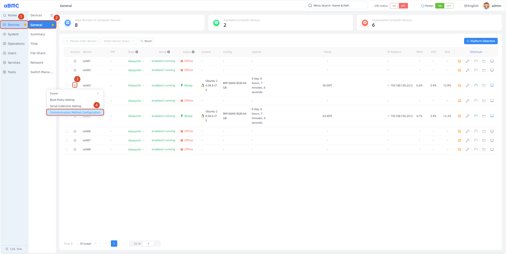
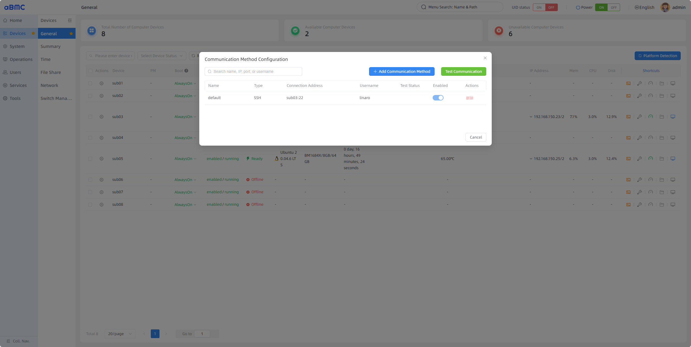
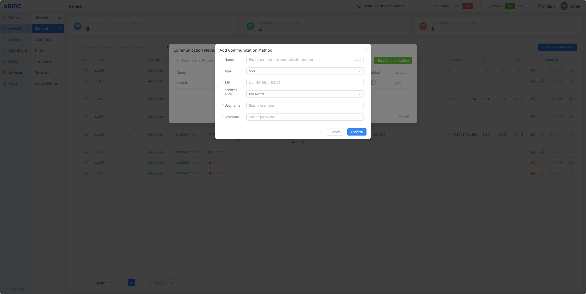
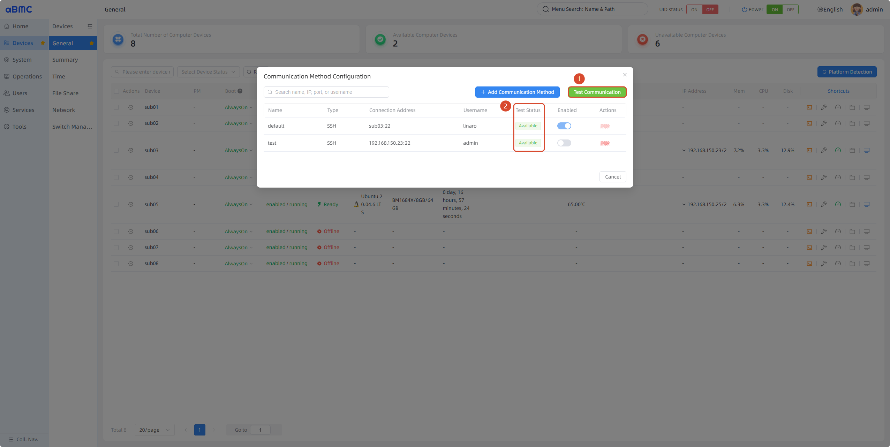
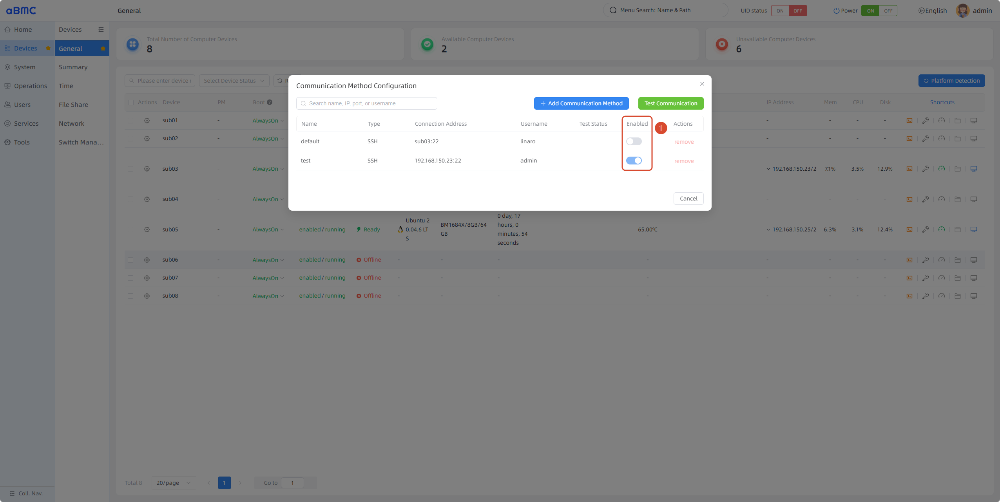
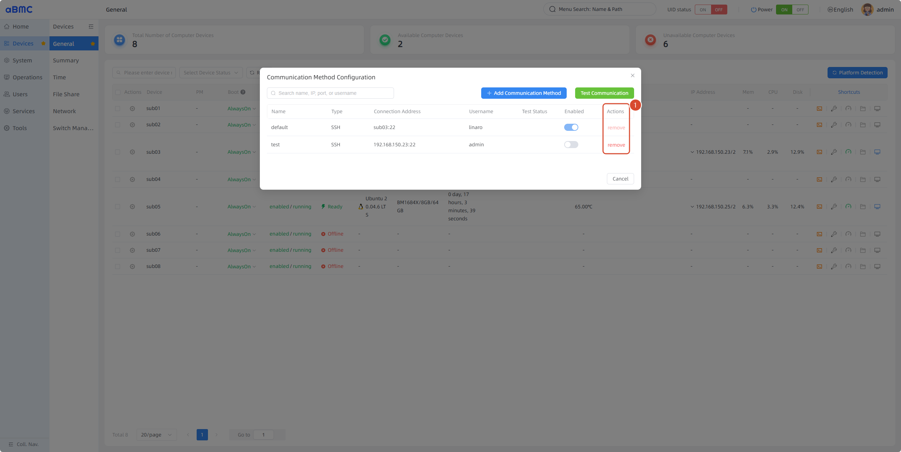

# Sub-Board Communication Management

## Introduction

Sub-Board Communication Management (Sub Communication Manager) is a fundamental feature that aBMC provides for array servers to establish and maintain communication links with each sub-board. Through this feature, you can customize the basic communication method between the BMC and sub-boards. aBMC establishes the communication link with sub-boards through the specified communication method, and the availability of the link determines the **device status** and the availability of other management features provided by aBMC.

<Callout title="Version Requirement" type="info">
    aBMC version >= v3.2.0
</Callout>

## Development Vision

1. Enable users to intuitively see the communication method used between each sub-board and the BMC.
2. Enable users to freely choose the communication method between each sub-board and the BMC.

# Feature Usage

## Viewing and Configuring Communication Methods

<CodeBlockTabs defaultValue="WEB">
  <CodeBlockTabsList>
    <CodeBlockTabsTrigger value="WEB">WEB</CodeBlockTabsTrigger>
    <CodeBlockTabsTrigger value="API">API</CodeBlockTabsTrigger>
  </CodeBlockTabsList>

  <CodeBlockTab value="WEB">
    ### Open the communication method configuration window [step]

    1. Select **Devices** in the left main navigation bar.
    2. Select **General** in the secondary navigation bar.
    3. Locate the target sub-board in the device list and click the **⚙️** icon.
    4. Select **Communication Method Configuration**.

    

    ### View the communication method list [step]

    | Field | Description |
    | --- | --- |
    | Name | The name of the communication method; `default` represents the factory default communication method. |
    | Type | The type of the communication method. Currently USB ADB and SSH are supported; only SSH is supported when adding a new one. |
    | Connection Address | The connection address of the communication method. |
    | Username | The connection user of the communication method. |
    | Test Status | The test result of the communication method. |
    | Enabled | Whether the communication method is currently enabled. |
    | Actions | Operations; currently only the remove operation is supported. |

    

    ### Add a communication method [step]

    Click **Add Communication Method** in the example figure of the previous step.

    1. Enter the communication method name in **Name**.
    2. Select the communication method type in **Type**; currently only SSH is supported.
    3. Enter the SSH connection address.
    4. Select the SSH authentication method. Both password authentication and key authentication are currently supported. When key authentication is selected, generate a key pair yourself, store the public key on the sub-board, and upload the private key in this window.
    5. Enter the username.
    6. Enter the password or private key.
    7. Click **Confirm** to add the communication method.

    

    ### Test a communication method [step]

    After a communication method is added, you can test whether it is available:

    1. Click **Test Communication**.
    2. The test result is displayed in the **Test Status** column.

    

    ### Enable a communication method [step]

    After the new communication method passes the test, you can enable it:

    1. Click the button in the **Enabled** column.
    2. After switching the communication method, the corresponding device goes offline briefly until the new connection succeeds.

    

    ### Remove a communication method [step]

    1. Click the remove button in the **Actions** column.
    2. In the dialog, click **Confirm** to confirm the removal.

    
  </CodeBlockTab>

  <CodeBlockTab value="API">
    | Operation | Method | URI |
    | --- | --- | --- |
    | View the communication configuration collection | GET | `/redfish/v1/Oem/Firefly/{ComputerSystemId}/CommConfigs` |
    | Add a communication configuration | POST | `/redfish/v1/Oem/Firefly/{ComputerSystemId}/CommConfigs/Actions/Create` |
    | Test a communication configuration | POST | `/redfish/v1/Oem/Firefly/{ComputerSystemId}/CommConfigs/Actions/Test` |
    | Enable a communication configuration | POST | `/redfish/v1/Oem/Firefly/{ComputerSystemId}/CommConfigs/Actions/Enable` |
    | Remove a communication configuration | POST | `/redfish/v1/Oem/Firefly/{ComputerSystemId}/CommConfigs/Actions/Delete` |

    <Callout title="Note" type="info">
      For detailed information about interface authentication, request parameters, response fields, and error codes, refer to the Redfish API documentation.
    </Callout>
  </CodeBlockTab>
</CodeBlockTabs>

## FAQ

### 1. The remove button of a communication method is grayed out

The communication method named `default` is the factory default communication method. It can be left unused, but cannot be removed. For the communication method currently in use, switch to another communication method before removing it.

### 2. After switching the communication method, the device goes offline briefly and then recovers

The device status is determined by the state of the communication link. After switching the communication method, the original communication link is automatically disconnected and the device goes offline. A new communication link is then established, and the device recovers after the new link is established successfully.
