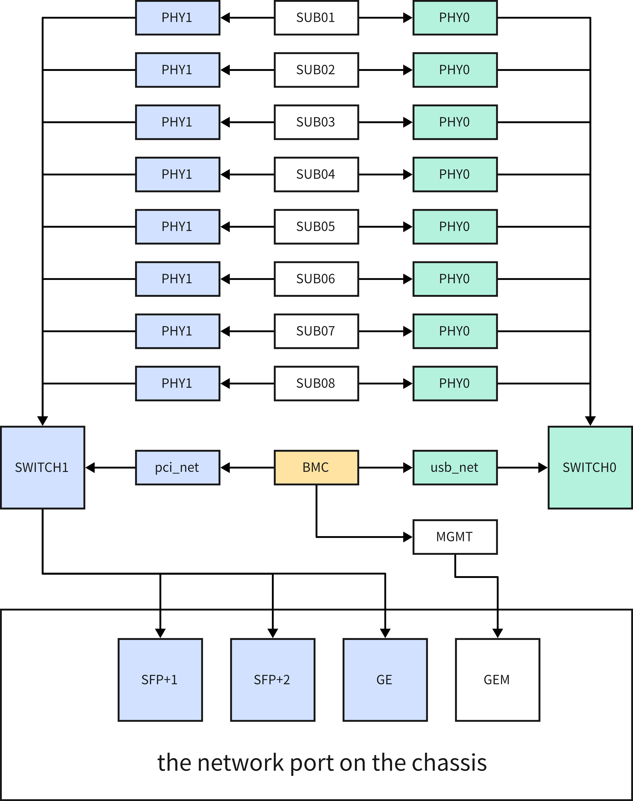
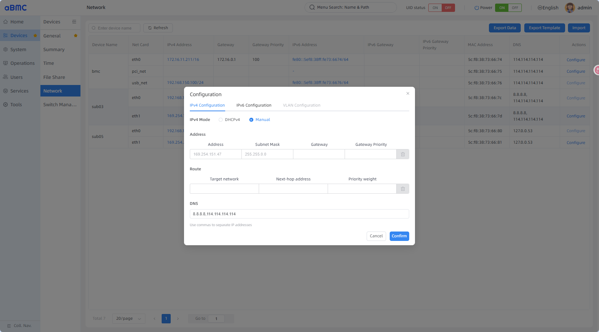
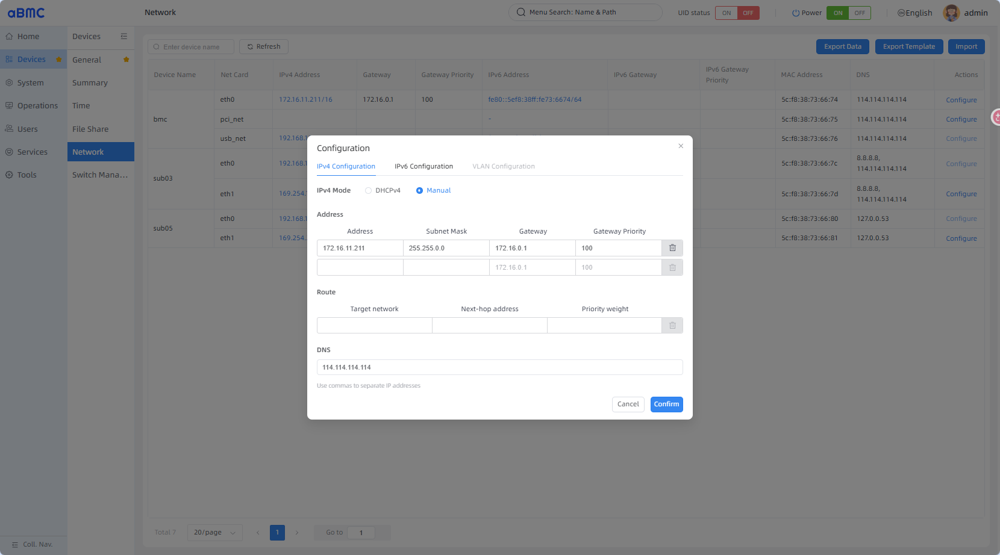

# Network Sharing Case

## Overview

When deploying array servers at scale, the site network environment is often not known during project planning. Constraints such as a limited public IP quota, strict network control, and a ban on configuring multiple public IPs usually surface only during deployment.

The traditional architecture uses a one-to-one "one core board, one public IP" model: every core board needs its own public IP, either requested separately or configured manually. This model only works for small deployments. In a large array cluster it causes IP shortages, non-compliant multi-IP deployment, high O&M costs, and wasted addresses. Adding a router increases hardware and maintenance costs and requires multi-department coordination, budget approval, and procurement, which extends the deployment cycle.

This case uses a high-speed BMC NIC (5 Gbps or higher recommended) with the internal L3 switch to create WAN and LAN logical interfaces through VLANs, and enables NAT and IP forwarding on the BMC so that the whole cluster uses only one public IP. The goal is to reduce public IP consumption, simplify O&M, improve address utilization, and isolate the internal and external networks without adding network devices.

## Intended Audience

- **Network administrators and delivery engineers**: the site has a limited public IP quota or forbids bulk configuration of multiple public IPs.
- **Operations staff**: want to reduce the work of configuring IP addresses for each sub-board and the associated maintenance cost.
- **Project owners**: need to deploy the cluster without major changes to the site network.

## Application Scenario

As the number of cluster nodes grows, the limitations of the one-to-one IP model become obvious:

| Site problem | Details | How this case addresses it |
| --- | --- | --- |
| High cost and long approval cycle for new network devices | A router adds hardware and maintenance costs; a temporary device also requires multi-department coordination, budget approval, and procurement | No additional router; reuse the BMC's NAT and IP forwarding |
| Public IP shortage | Installing one server consumes more than ten public IPs | The whole cluster uses only one public IP |
| Complex network O&M | IP addresses must be configured, recorded, and maintained one by one; bulk changes easily cause IP conflicts, parameter errors, and inconsistent records | Sub-boards use internal addresses; only the BMC needs a public address |
| Low public IP utilization | Most core boards only perform routine data exchange but each holds a public IP | Internal addresses do not consume public IPs; the public address is shared |

This case applies to clusters with a limited public IP quota, a ban on bulk configuration of multiple public IPs, or a requirement to avoid adding a router. If public IPs are sufficient, assign an independent IP to each sub-board and do not enable this case.

## Network Topology

Physical connections on a single CSA1-N8: one chassis holds eight sub-boards (SUB01–SUB08). Each sub-board has a PHY NIC on both sides, connected to two internal switches. The BMC connects to the two switches through its pci_net and usb_net NICs. SFP+1, GE, SFP+2, and GEM are the external ports on the chassis front panel. The VLAN split and NAT in this case are built on these physical links.



*Figure: CSA1-N8 single-unit network topology. This case only uses the SWITCH0 side; the SWITCH1 side stays idle.*

## How It Works

Disable all PHY1 NICs on the server. Traffic flows as follows:

1. It enters through the GE port on the chassis and reaches the BMC's eth0 NIC (the external NIC).
2. The BMC performs NAT and IP forwarding, and the traffic leaves through the usb_net NIC.
3. It goes through switch SWITCH0 and finally reaches the sub-board's eth0 NIC.

## Procedure

### Step 1: Configure the sub-board eth1 IP and DNS [step]

Set the sub-board to manual mode, leave the IP address empty, and configure DNS:



### Step 2: Add a new network configuration on the sub-board [step]

```bash
linaro@bm1684:~$ sudo cat /etc/netplan/eth0_static_ip.yaml 
network:
        version: 2
        renderer: NetworkManager
        ethernets:
                eth0:
                        dhcp4: no
                        addresses: [192.168.150.23/24]
                        optional: yes
linaro@bm1684:~$ sudo cat /etc/netplan/default.yaml 
network:
  version: 2
  renderer: NetworkManager
  ethernets:
    eth0:
      dhcp4: false
      dhcp6: false
      addresses:
      - 192.168.150.23/24
      optional: true
      routes:
      - to: 0.0.0.0/0
        via: 192.168.150.100
        metric: 100
linaro@bm1684:~$ 
```

1. Create `/etc/netplan/default.yaml` and set the route to `192.168.150.100`, which is the IP of the BMC's usb_net NIC.
2. Set the eth0 address to the one in `/etc/netplan/eth0_static_ip.yaml`.
3. Run `sudo netplan apply` to apply the configuration.
4. Run `ip a` and `route -n` to check the result: eth0 should hold `192.168.150.23/24`, and the `0.0.0.0` route should use gateway `192.168.150.100`.

```bash
linaro@bm1684:~$ ip a
1: lo: <LOOPBACK,UP,LOWER_UP> mtu 65536 qdisc noqueue state UNKNOWN group default qlen 1000
    link/loopback 00:00:00:00:00:00 brd 00:00:00:00:00:00
    inet 127.0.0.1/8 scope host lo
       valid_lft forever preferred_lft forever
    inet6 ::1/128 scope host
       valid_lft forever preferred_lft forever
    ... (dummy0, sit0, and other unrelated interfaces omitted)
4: eth0: <BROADCAST,MULTICAST,UP,LOWER_UP> mtu 1500 qdisc mq state UP group default qlen 1000
    link/ether 5c:f8:38:73:66:7c brd ff:ff:ff:ff:ff:ff
    inet 192.168.150.23/24 brd 192.168.150.255 scope global noprefixroute eth0
       valid_lft forever preferred_lft forever
    inet6 fe80::5ef8:38ff:fe73:667c/64 scope link 
       valid_lft forever preferred_lft forever
5: eth1: <BROADCAST,MULTICAST,UP,LOWER_UP> mtu 1500 qdisc mq state UP group default qlen 1000
    link/ether 5c:f8:38:73:66:7d brd ff:ff:ff:ff:ff:ff
    inet 169.254.151.47/16 brd 169.254.255.255 scope link noprefixroute eth1
       valid_lft forever preferred_lft forever
    inet6 fe80::5ef8:38ff:fe73:667d/64 scope link noprefixroute
       valid_lft forever preferred_lft forever
    ... (docker0 omitted)
linaro@bm1684:~$ route -n
Kernel IP routing table
Destination     Gateway         Genmask         Flags Metric Ref    Use Iface
0.0.0.0         192.168.150.100 0.0.0.0         UG    100    0        0 eth0
169.254.0.0     0.0.0.0         255.255.0.0     U     101    0        0 eth1
172.17.0.0      0.0.0.0         255.255.0.0     U     0      0        0 docker0
192.168.150.0   0.0.0.0         255.255.255.0   U     100    0        0 eth0
224.0.0.0       0.0.0.0         240.0.0.0       U     101    0        0 eth1
linaro@bm1684:~$ 
```

eth1 has an address in the 169.254.x.x range; ignore it.
Confirm that the first entry in the routing table uses 192.168.150.100 as its gateway.

### Step 3: Configure the BMC eth0 NIC [step]



<Callout title="A static IP is required" type="warn">
  The NAT rules below depend on this address; if DHCP assigns the address dynamically, the NAT rules will not take effect.
</Callout>

### Step 4: Configure NAT and IP forwarding on the BMC [step]

Log in to the BMC:

```bash
# Enable IP forwarding
echo 1 > /proc/sys/net/ipv4/ip_forward

# Make it persistent
echo "net.ipv4.ip_forward = 1" >> /etc/sysctl.conf
sysctl -p

# Configure NAT rules
iptables-legacy -t nat -A PREROUTING -i eth0 ! -d 172.16.11.211 -j DNAT --to-destination 192.168.150.1-192.168.150.200

# Outbound only: source NAT for compute cores accessing the external network
iptables-legacy -t nat -A POSTROUTING -o eth0 -j MASQUERADE

# Show the rules
iptables-legacy -t nat -L -n -v
```

#### Persist the NAT rules

The iptables rules above live only in memory and are lost after a reboot. Use a systemd service to load the two rules at startup.

1. Create the service unit `/etc/systemd/system/nat-forward.service`:

```bash
cat > /etc/systemd/system/nat-forward.service <<'EOF'
[Unit]
Description=Persist NAT forwarding rules
After=network-online.target
Wants=network-online.target

[Service]
Type=oneshot
RemainAfterExit=yes
ExecStart=/usr/sbin/iptables-legacy -t nat -A PREROUTING -i eth0 ! -d 172.16.11.211 -j DNAT --to-destination 192.168.150.1-192.168.150.200
ExecStart=/usr/sbin/iptables-legacy -t nat -A POSTROUTING -o eth0 -j MASQUERADE

[Install]
WantedBy=multi-user.target
EOF
```

2. Enable and start the service:

```bash
systemctl daemon-reload
systemctl enable nat-forward.service
systemctl start nat-forward.service
```

3. Check the service status and the rules:

```bash
systemctl status nat-forward.service --no-pager
iptables-legacy -t nat -L -n -v
```

`systemctl status` should show `active (exited)`, and `iptables-legacy -t nat -L -n -v` should list both the DNAT and MASQUERADE rules. The service reapplies them on every reboot after that.

<Callout title="Note" type="warn">
  Each start appends the rules again, so repeated `systemctl restart` calls create duplicate entries — reboot the device to clear them. The service only handles iptables rules; `ip_forward` is already persisted through `/etc/sysctl.conf` above. The BMC eth0 must keep its static IP (see Step 3); after changing the eth0 address, update the addresses in this service and run `systemctl restart nat-forward.service`.
</Callout>

### Step 5: Verify one-way communication [step]

| Test | Procedure | Expected result |
| --- | --- | --- |
| Compute core to site network | Run `ping 172.16.0.1` on a sub-board | Ping succeeds |
| Compute core to the Internet | Run `ping www.baidu.com` on a sub-board | Ping succeeds (DNS must be configured on the sub-board) |
| Site network to compute core intranet | Ping a sub-board internal address (for example `192.168.150.21`) from a site network terminal | **Ping fails (expected)** |