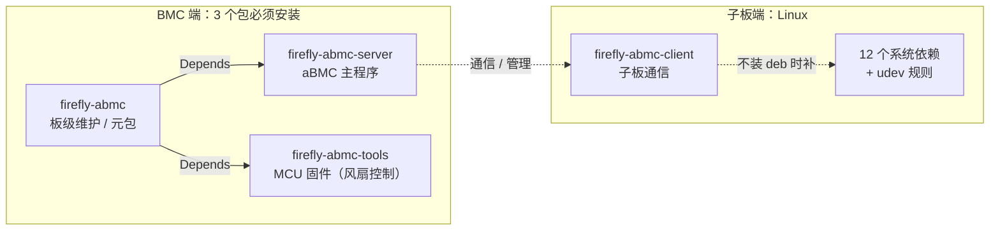

# 软件安装指南

本指南介绍 aBMC 软件包的下载方式、版本目录结构、包关系，以及 BMC 端与子板端的安装与升级步骤。

## 下载地址

资料包[下载地址](https://pan.baidu.com/s/15kfthwxS8cbRJxC_tXggCA?pwd=jctu)（提取码：`jctu`）

### 目录结构

aBMC 目录按版本划分为多个子目录，版本号由大到小排列，最靠前的为最新版本。

```text
aBMC
├── v3.2.3
├── v3.2.0
├── v3.1.3
└── v2.9.4
```

以 v3.2.3 为例，版本目录中包含以下文件：

| 文件名 | 说明 |
| :--- | :--- |
| `firefly-abmc-server_3.2.3-1793180173_arm64.deb` | 服务端主程序 |
| `firefly-abmc-tools_1.1.0_arm64.deb` | 工具集（MCU 固件） |
| `firefly-abmc_3.2.3-1793180173_all.deb` | 元包，用于一次性安装服务端与工具集 |
| `firefly-abmc-client_1.0.1_all.deb` | 子板通信依赖包 |
| `readme_zh.txt` / `readme_en.txt` | 安装命令与更新日志说明 |

## 软件包关系

BMC 端的三个包需要全部安装；子板端需要安装 client 包，或者补装 client 包声明的系统依赖和 udev 规则。



| 包 | 安装位置 | 作用 |
| :--- | :--- | :--- |
| `firefly-abmc` | BMC | 板级维护服务 / 元包；依赖 server 与 tools，包含 ADB、服务保活、子板复位、按键、烧录等板级服务 |
| `firefly-abmc-server` | BMC | aBMC 主程序：Web 管理、节点服务、升级与恢复工具 |
| `firefly-abmc-tools` | BMC | MCU 固件（风扇控制） |
| `firefly-abmc-client` | 子板 | 子板与 aBMC 通信所需的运行环境；也可用「12 个系统依赖 + udev 规则」替代 |

## 安装与升级

安装或升级 aBMC 时，BMC 与子板均需联网（可访问软件源），以便 `apt` 解析和安装依赖包。

### BMC 端 [step]

将以下 deb 包上传到 BMC：

- `firefly-abmc-server*.deb`
- `firefly-abmc-tool*.deb`
- `firefly-abmc_*all.deb`

登录 BMC，进入 deb 包所在目录后执行：

```bash
sudo apt install -y ./firefly-abmc-server*.deb ./firefly-abmc-tool*.deb ./firefly-abmc_*all.deb
```

### 子板端 [step]

推荐直接安装 client 包。将以下 deb 包上传到子板：

- `firefly-abmc-client*.deb`

登录子板，进入 deb 包所在目录后执行：

```bash
sudo apt install -y ./firefly-abmc-client*.deb
```

#### client 包内容

```text
firefly-abmc-client/
├── etc/
│   ├── runtime-monitor.ini
│   └── udev/rules.d/99-rockchip-permissions.rules
├── lib/systemd/system/runtime-monitor.service
└── usr/local/bin/
    ├── runtime-monitor-arm64
    └── runtime-monitor-riscv64
```

#### 不安装 client 包时

如果不安装 client deb，需要手动补装它声明的系统依赖和 udev 规则，否则会影响子板与 aBMC 的通信。

安装系统依赖：

```bash
sudo apt install -y nftables chrony nfs-kernel-server nfs-common samba \
  cifs-utils sshfs logrotate i2c-tools ethtool netplan.io lsof
```

补 udev 规则：

<Callout title="说明" type="info">
  该 udev 规则适用于 RK 平台。非 RK 平台的子板在不安装 client deb 时，可以不执行这段 udev 规则。
</Callout>

<details>
<summary>查看 udev 规则内容</summary>

```bash
sudo tee /etc/udev/rules.d/99-rockchip-permissions.rules >/dev/null <<'EOF'
ACTION=="remove", GOTO="permissions_end"

# VPU devices
KERNEL=="avsd", MODE="0660", GROUP="video"
KERNEL=="vepu", MODE="0660", GROUP="video"
KERNEL=="h265e", MODE="0660", GROUP="video"
KERNEL=="rkvdec", MODE="0660", GROUP="video"
KERNEL=="rkvenc", MODE="0660", GROUP="video"
KERNEL=="mpp_service", MODE="0660", GROUP="video"
KERNEL=="vpu[_-]service", MODE="0660", GROUP="video"
KERNEL=="hevc[_-]service", MODE="0660", GROUP="video"

# RGA device
KERNEL=="rga", MODE="0660", GROUP="video"

# MALI devices
KERNEL=="mali*", MODE="0660", GROUP="video"

SUBSYSTEM=="mmc_rpmb" KERNEL=="mmcblk*[0-9]rpmb", MODE="0666"

# DMA heap devices
KERNEL=="cma", MODE="0660", GROUP="video"
KERNEL=="cma-uncached", MODE="0660", GROUP="video"
KERNEL=="system", MODE="0660", GROUP="video"
KERNEL=="system-dma32", MODE="0660", GROUP="video"
KERNEL=="system-uncached", MODE="0660", GROUP="video"
KERNEL=="system-uncached-dma32", MODE="0660", GROUP="video"

LABEL="permissions_end"
EOF

sudo udevadm control --reload-rules
sudo udevadm trigger
```

</details>

### 验证 [step]

登录 BMC 后执行以下命令，查看 aBMC 服务运行状态：

```bash
systemctl status aBMC
```

服务状态为 `active (running)`，表示安装或升级成功。之后即可登录 aBMC Web 管理页面，具体方法参见[登录指南](guide.md)。

子板端安装完成后，确认子板在 aBMC Web 中显示为在线，表示子板与 aBMC 通信正常。
