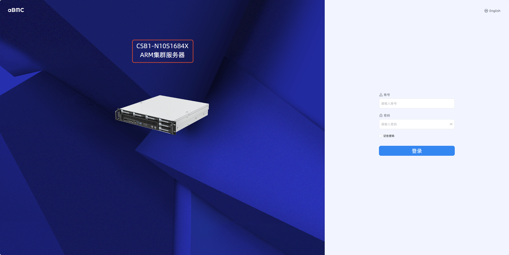
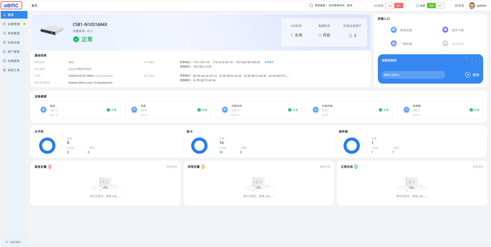

# 页面自定义指南

本指南介绍如何自定义 aBMC 登录页面和管理页面的产品信息与图标。

## 前言

页面自定义需要修改服务器 BMC 管理设备上的文件，目录路径为 `/etc/aBMC/cus`。该路径下文件的介绍如下：

- `config.json`：配置产品名称和产品类型。
- `loginLogo.svg`：配置登录页面的 Logo 图标。
- `product.svg`：配置登录页面和管理页面的产品图标。
- `headerLogo.svg`：配置管理页面的 Logo 图标。

<Callout title="提示" type="info">
    后续步骤中的文件均指 BMC 管理设备上 `/etc/aBMC/cus/` 下的同名文件；修改任一文件后，需执行 `sudo systemctl restart aBMC` 重启服务。
</Callout>

## 登录页面自定义

### 产品名称和类型自定义 [step]

1. 编辑 `config.json`，修改 `productName` 字段和 `productType` 字段，前者是产品名称，后者是产品类型。
2. 重启 aBMC 服务。
3. 刷新登录页面，查看下图红框的位置是否发生了变化。上面那行文本是产品名称，下面那行文本是产品类型。

### Logo 图标自定义 [step]

1. 上传 SVG 文件覆盖 `loginLogo.svg`。
2. 重启 aBMC 服务。
3. 刷新登录页面，查看下图红框的位置是否发生了变化。

### 产品图标自定义 [step]

1. 上传 SVG 文件覆盖 `product.svg`。
2. 重启 aBMC 服务。
3. 刷新登录页面，查看下图红框的位置是否发生了变化。

## 管理页面自定义

### 产品名称自定义 [step]

1. 编辑 `config.json`，修改 `productName` 字段。
2. 重启 aBMC 服务。
3. 刷新管理页面，查看下图红框的位置是否发生了变化。

### Logo 图标自定义 [step]

1. 上传 SVG 文件覆盖 `headerLogo.svg`。
2. 重启 aBMC 服务。
3. 刷新管理页面，查看下图红框的位置是否发生了变化。

### 产品图标自定义 [step]

1. 上传 SVG 文件覆盖 `product.svg`。
2. 重启 aBMC 服务。
3. 刷新管理页面，查看下图红框的位置是否发生了变化。

