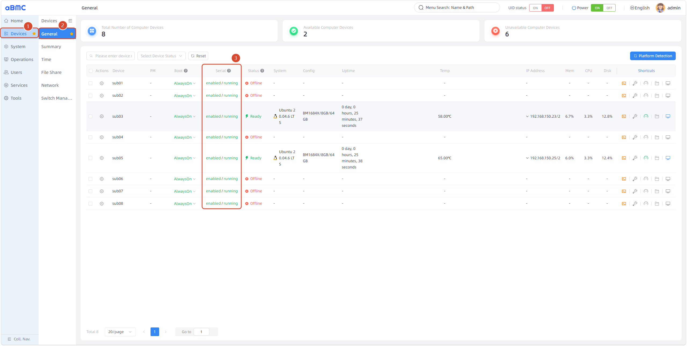
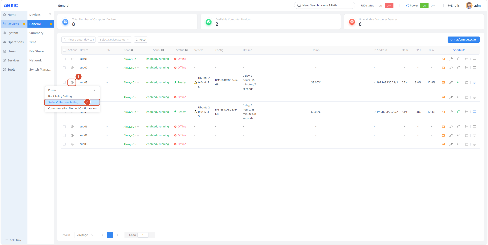
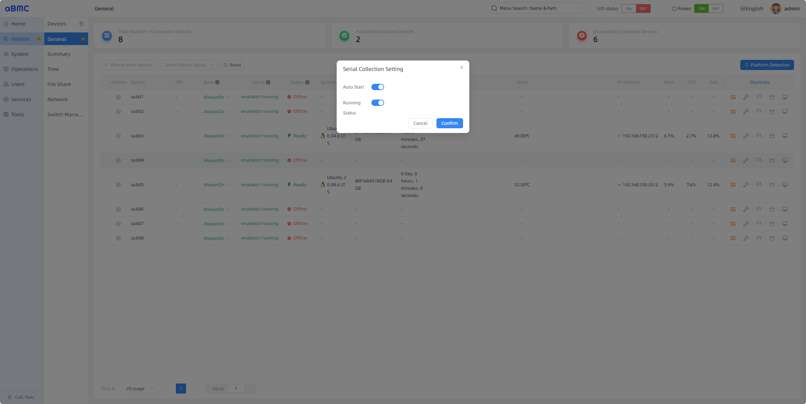
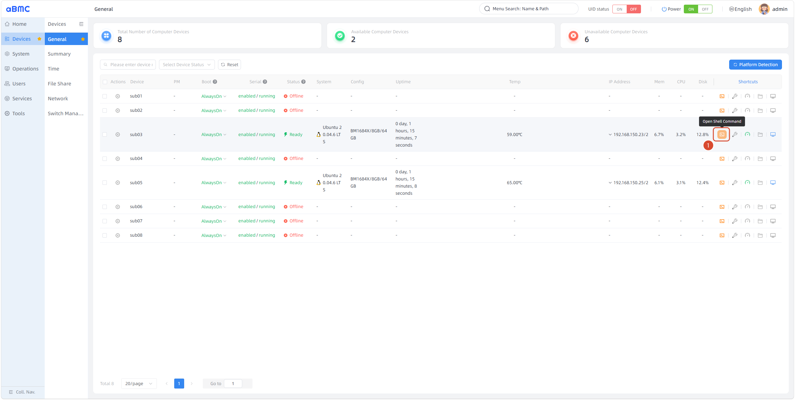
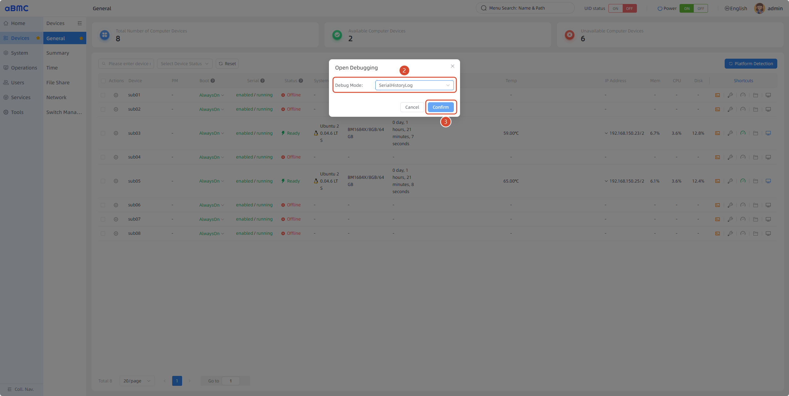

# 子板串口采集

## 简介

子板串口采集（Sub Serial Collection）是 aBMC 面向阵列式服务器提供的子板串口输出采集功能。通过该功能可以在 aBMC 运行期间，持续采集并记录子板的串口输出。采集运行期间，子板串口输出被实时聚合为人类可读的日志文本，统一写入系统日志服务（journald），并以子板标识字段区分归属，运维人员可按子板检索、回溯串口历史，为故障定位与宕机复盘提供可信的时间线依据。

<Callout title="版本支持" type="info">
    本功能自 v3.1.0 版本后开始支持。
</Callout>

## 开发愿景

1. 让用户可以通过串口的历史输出来定位故障问题。
2. 提供便捷、精细化的操作逻辑和 API 接口，让用户自由选择是否开启指定子板的串口采集功能。

# 功能使用

## 查看和配置串口采集

<CodeBlockTabs defaultValue="WEB">
    <CodeBlockTabsList>
        <CodeBlockTabsTrigger value="WEB">WEB</CodeBlockTabsTrigger>
        <CodeBlockTabsTrigger value="API">API</CodeBlockTabsTrigger>
    </CodeBlockTabsList>

    <CodeBlockTab value="WEB">
        ### 查看串口采集配置 [step]

        1. 在左侧主导航栏中选择 **Devices**。
        2. 在二级导航栏中选择 **General**，进入**设备概览**页面。
        3. **Serial** 列就是子板的串口采集配置。

        前一个值是串口采集的自启动状态，enabled 表示当 aBMC 服务启动时，会尝试开启串口采集功能，disabled 则不会；后一个值是串口采集的运行状态，running 表示串口采集服务正在运行，exited 表示串口采集服务已经停止运行。

        

        ### 配置串口采集 [step]

        在第一步所处页面的基础上：

        1. 在设备列表中定位目标子板，点击 **⚙️** 图标。
        2. 选择 **Serial Collection Setting**。

        

        | Field | 说明 |
        | --- | --- |
        | Auto Start | 控制串口采集的自启动状态 |
        | Running Status | 控制串口采集的运行状态 |

        

        <Callout title="提示" type="info">
            Auto Start 控制的是下次 aBMC 启动时是否尝试开启串口采集功能；而 Running Status 控制的是本次 aBMC 运行期间，串口采集的开启和关闭。
        </Callout>

        ### 查看串口历史输出 [step]

        开启了串口采集后，就可以查看串口的历史输出。在第一步所处页面的基础上：

        1. 在设备列表中定位目标子板，点击终端图标。
        2. **Debug Mode** 选择 **SerialHistoryLog**。
        3. 点击 **Confirm** 进入控制台页面查看。

        
        

        <Callout title="提示" type="info">
            串口历史输出页面支持以下常用按键：
            
            | 按键 | 作用 |
            | --- | --- |
            | ↑ / ↓ | 逐行向上 / 向下滚动 |
            | PgUp / PgDn | 向上 / 向下翻页 |
            | g / G | 跳转至日志开头 / 末尾（G 可直达最新记录） |
            | /关键字 + 回车 | 搜索日志，按 n / N 在匹配项间向下 / 向上跳转 |
        </Callout>
    </CodeBlockTab>

    <CodeBlockTab value="API">
        | 操作 | 方法 | URI |
        | --- | --- | --- |
        | 获取串口采集状态 | GET | `/redfish/v1/Managers/{ManagerId}/Oem/Firefly/SerialCollect` |
        | 配置串口采集 | POST | `/redfish/v1/Managers/{ManagerId}/Oem/Firefly/SerialCollect/Actions/Configure` |
        | 查看串口历史输出 | GET（Websocket） | `/redfish/v1/Managers/{ManagerId}/Oem/Firefly/Terminal/Webtty` |

        <Callout title="提示" type="info">
            关于接口认证、请求参数、返回字段和错误码的详细说明，请查看 Redfish API 文档。
        </Callout>
    </CodeBlockTab>
</CodeBlockTabs>
