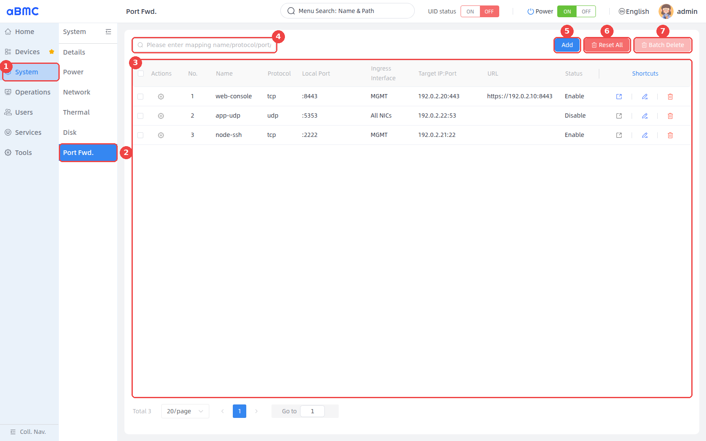
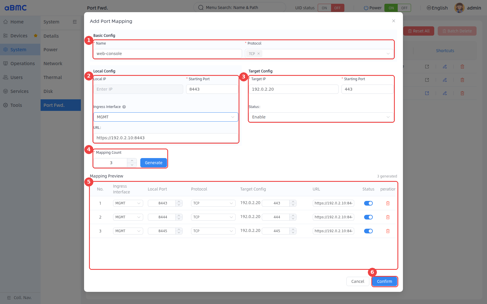
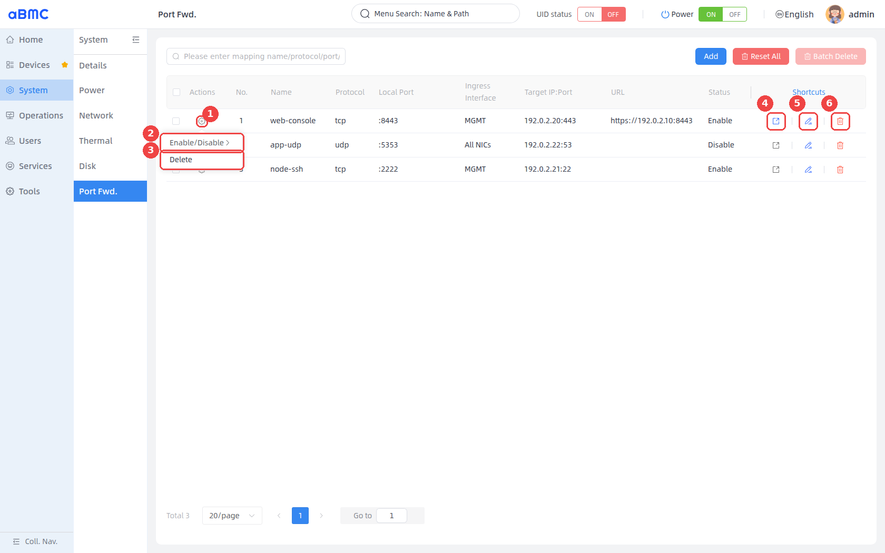
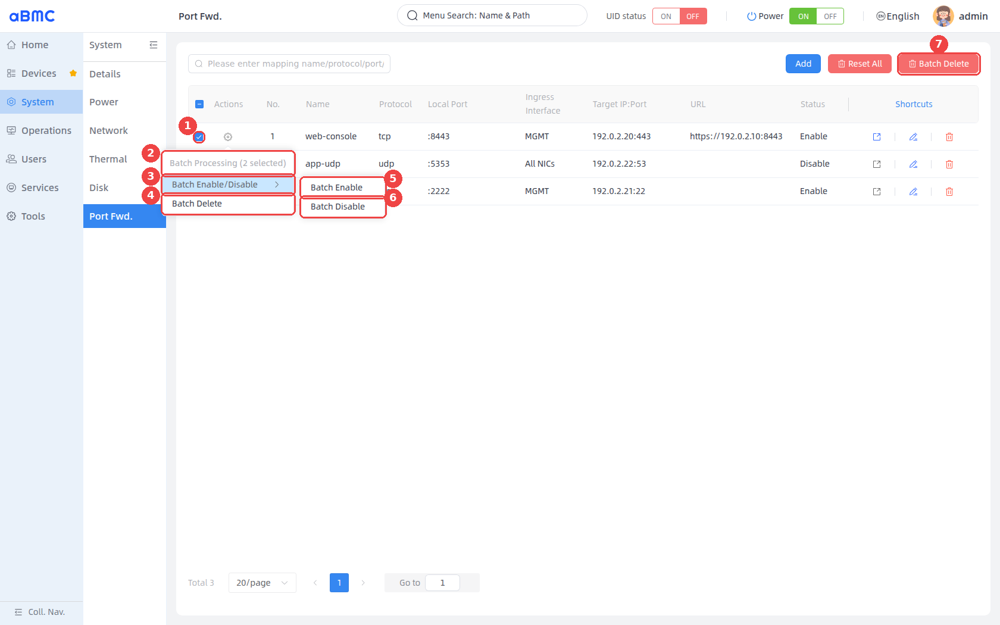

# 端口映射

## 简介

端口映射（Port Forwarding）是面向阵列式服务器设计的流量转发管理功能。该功能由规则管理和页面跳转两大模块组成：

1.规则管理：负责统一创建、启用、禁用、编辑和删除转发规则。

2.页面跳转：支持一键跳转至客户部署于服务器内阵列子节点的管理网页，便于快速访问

<Callout title="版本要求" type="info">
    aBMC 版本 >= v3.2.4
</Callout>

## 开发愿景
1.为用户提供统一网络入口，用以简化运维流程，降低阵列子节点地址、路由及访问入口的管理成本。

2.用户可以使用规则管理对流量进行精细化的控制，有效避免阵列子节点内不必要的端口暴露。

# 功能使用

## 查看端口映射

<CodeBlockTabs defaultValue="WEB">
  <CodeBlockTabsList>
    <CodeBlockTabsTrigger value="WEB">WEB</CodeBlockTabsTrigger>
    <CodeBlockTabsTrigger value="API">API</CodeBlockTabsTrigger>
  </CodeBlockTabsList>

  <CodeBlockTab value="WEB">
    ### 打开端口映射页面 [step]

    1. 在左侧主导航中选择 **System**。
    2. 二级导航栏选择 **Port Fwd.**
    3. 等待规则列表和分页区域完成加载，查看当前规则；没有规则时，列表显示 **No Data**。
    4. 需要查找规则时，在搜索框中输入映射名称、协议、端口、IP、状态或 URL。
    5. 需要创建规则时，单击 **Add**。
    6. 需要批量删除规则时，勾选目标规则后单击 **Batch Delete**。
    7. 需要清空全部规则时，单击 **Reset All**。

    

    ### 列表字段说明 [step]

    | Field | 说明 |
    | --- | --- |
    | Actions | 打开规则操作菜单。勾选多条规则时，菜单中提供批量启用、批量禁用和批量删除。 |
    | No. | 规则在当前分页中的序号。 |
    | Name | 映射名称，用于识别转发服务或使用场景。 |
    | Protocol | 转发使用的传输层协议，取值为 tcp 或 udp。 |
    | Local Port | BMC 对外监听的本地端口，显示格式为 `:端口`。管理主机通过该端口访问映射服务。 |
    | Ingress Interface | 规则生效的入接口。仅转发从该接口进入的流量；未指定时为 **All NICs**。 |
    | Target IP:Port | 流量最终转发到的目标 IPv4 地址和服务端口。 |
    | URL | 为 Web 服务配置的快捷访问地址。 |
    | Status | 规则当前为 **Enable** 或 **Disable**。 |
    | Shortcuts | 提供打开 URL、编辑规则和删除规则的快捷图标；未配置 URL 时，打开图标不可用。 |

    <Callout title="访问路径" type="info">
      端口转发路径为：管理主机 → `BMC_IP:Local Port` → `Target IP:Target Port`。URL 只用于页面快捷访问，不替代实际的目标 IP 和目标端口配置。
    </Callout>

    <Callout title="启用与删除的差异" type="warn">
      **Disable** 只停止转发、保留配置；**Delete**、**Batch Delete** 和 **Reset All** 都会删除规则，删除后相关端口转发立即失效。**Reset All** 会删除当前设备的全部规则。
    </Callout>
  </CodeBlockTab>

  <CodeBlockTab value="API">
    | 操作 | 方法 | URI |
    | --- | --- | --- |
    | 查看端口映射列表 | GET | `/redfish/v1/Systems/bmc/Oem/Firefly/PortMappings` |

    <Callout title="提示" type="info">
      关于接口认证、请求参数、返回字段和错误码的详细说明，请查看 Redfish API 文档。
    </Callout>
  </CodeBlockTab>
</CodeBlockTabs>

## 新增端口映射

<CodeBlockTabs defaultValue="WEB">
  <CodeBlockTabsList>
    <CodeBlockTabsTrigger value="WEB">WEB</CodeBlockTabsTrigger>
    <CodeBlockTabsTrigger value="API">API</CodeBlockTabsTrigger>
  </CodeBlockTabsList>

  <CodeBlockTab value="WEB">
    ### 确认网络规划 [step]

    新增规则前，应先确认转发协议、BMC 本地监听端口、入接口、目标设备地址、目标服务端口和规则初始状态。本地端口不能与 BMC 系统服务或其他映射规则冲突，目标服务应能够从 BMC 所在网络访问。

    ### 填写基础配置 [step]

    在端口映射页面单击 **Add**，打开 **Add Port Mapping** 窗口，然后按照下图配置：

    1. 在 **Basic Config** 中填写 **Name**。
    2. 选择 **Protocol**，可选 TCP 或 UDP，默认 TCP。
    3. 在 **Local Config** 中填写 BMC 对外监听的 **Starting Port**。**Local IP** 由系统分配，页面中不可编辑。
    4. 选择 **Ingress Interface**，即规则生效的入接口。可选 **All NICs** 或具体网口；悬停提示说明：仅转发从该接口进入的流量，留空时对所有接口生效，管理口为 MGMT。
    5. 需要 Web 快捷入口时，在 **URL** 中填写完整访问地址。
    6. 在 **Target Config** 中填写 **Target IP** 和 **Starting Port**，并选择 **Status** 为 **Enable** 或 **Disable**。

    

    ### 生成映射预览 [step]

    1. 在 **Mapping Count** 中填写本次需要生成的规则条数（正整数）。
    2. 单击 **Generate**，系统按起始端口连续生成对应条数的映射，并显示在 **Mapping Preview** 中。
    3. 在预览表中逐条核对 **Ingress Interface**、**Local Port**、**Protocol**、**Target Config**、**URL** 和 **Status**；如需调整，直接在该行修改。
    4. 需要剔除某一条时，单击该行右侧的删除图标。
    5. 预览为空时，列表提示 **Complete the form and generate mappings**。

    ### 保存规则 [step]

    1. 检查预览列表中的规则与网络规划一致。
    2. 单击 **Confirm** 保存。未生成预览时，**Confirm** 按钮不可用。
    3. 保存成功后页面提示 **Generated N port mappings**，规则出现在列表中。

    ### 参数说明 [step]

    | 参数 | 是否必填 | 说明 | 配置要求 |
    | --- | --- | --- | --- |
    | Name | 是 | 映射名称。 | 长度为 `1–32` 个字符，可使用中文、英文字母、数字、下划线和连字符。 |
    | Protocol | 是 | 端口转发使用的协议。 | 可选 TCP 或 UDP，默认 TCP，需与目标服务一致。 |
    | Local IP | 系统分配 | BMC 的本地监听地址。 | 页面只读，无需手动填写。 |
    | Starting Port | 是 | BMC 对外监听的本地起始端口。 | 填写 `1–65535` 范围内的整数，且不能被系统服务或其他规则占用。 |
    | Ingress Interface | 是 | 规则生效的入接口。 | 可选 **All NICs** 或具体网口；留空时等同 **All NICs**，管理口为 **MGMT**。 |
    | URL | 否 | **Shortcuts** 中打开图标使用的快捷地址。 | Web 服务建议填写包含协议、地址和端口的完整 URL；非 Web 服务可以留空。 |
    | Target IP | 是 | 接收转发流量的目标设备地址。 | 填写 BMC 可以访问的合法 IPv4 地址。 |
    | Starting Port | 是 | 目标设备上的起始服务端口。 | 填写 `1–65535` 范围内的整数，并确认目标服务正在监听该端口。 |
    | Status | 是 | 规则保存后的启停状态。 | **Enable** 表示保存后启用；**Disable** 表示仅保存配置，暂不转发。 |
    | Mapping Count | 是 | 本次批量生成的规则条数。 | 填写大于等于 `1` 的正整数；起始端口加条数减一不能超过 `65535`。 |

    ### 连续端口生成规则 [step]

    系统以填写的起始端口为起点，按 **Mapping Count** 连续生成多条规则，本地端口和目标端口同时递增。例如 **Starting Port** 为 `8443`、目标 **Starting Port** 为 `443`、**Mapping Count** 为 `3` 时：

    | No. | Ingress Interface | Local Port | Protocol | Target Config | 说明 |
    | --- | --- | --- | --- | --- | --- |
    | 1 | MGMT | `8443` | TCP | `192.0.2.20:443` | 第 1 条映射 |
    | 2 | MGMT | `8444` | TCP | `192.0.2.20:444` | 第 2 条映射 |
    | 3 | MGMT | `8445` | TCP | `192.0.2.20:445` | 第 3 条映射 |

    <Callout title="示例地址说明" type="info">
      `192.0.2.0/24` 是文档示例地址段。实际配置时，请替换为现场可用的 BMC 地址、目标设备地址和端口，不要直接使用示例值。
    </Callout>

    ### 校验提示 [step]

    | 提示信息 | 原因与处理 |
    | --- | --- |
    | Format error. Only Chinese, English letters, numbers, underscores, and hyphens are supported, with a length of 1-32 characters. | 名称不符合命名要求，按提示修改长度或字符。 |
    | Port must be in the range of 1-65535 | 本地或目标起始端口超出范围，改为 `1–65535` 之间的整数。 |
    | Please enter a valid target IP address | 目标 IP 格式错误，填写合法的 IPv4 地址。 |
    | Local ports TCP 3333 already exist. Change the starting port or count. | 本地端口已被占用，更换起始端口或减少条数。 |
    | Generated ports cannot exceed 65535 | 生成的端口超过 `65535`，减少 **Mapping Count** 或降低起始端口。 |

    ### 确认配置结果 [step]

    1. 返回规则列表，确认 **Name**、**Protocol**、**Local Port**、**Ingress Interface** 和 **Target IP:Port** 与网络规划一致。
    2. 确认 **Status** 为预期状态；设置为 **Enable** 时，从允许访问 BMC 的管理主机连接 `BMC_IP:Local Port`。
    3. 确认请求能够到达目标服务，并检查目标设备的服务状态、监听端口、防火墙和路由是否正常。
    4. 配置了 URL 时，单击 **Shortcuts** 中的打开图标，确认快捷地址可以访问。

    <Callout title="安全提示" type="warn">
      启用端口映射会为目标服务增加新的网络入口。只映射业务必需的服务，并结合入接口和现场网络策略限制访问来源。不要将不需要对外开放的管理端口长期保持启用。
    </Callout>
  </CodeBlockTab>

  <CodeBlockTab value="API">
    | 操作 | 方法 | URI |
    | --- | --- | --- |
    | 查询动作参数 | GET | `/redfish/v1/Systems/bmc/Oem/Firefly/PortMappings/Actions/ConfigureActionInfo` |
    | 设置端口映射 | POST | `/redfish/v1/Systems/bmc/Oem/Firefly/PortMappings/Actions/Configure` |

    <Callout title="提示" type="info">
      **Configure** 动作通过 `PortMappings` 数组提交规则，数组元素包含 `service_name`、`protocol`、`external_port`、`internal_ip`、`internal_port`、`external_ifname`、`status`、`RedirectUrl` 等字段，可一次提交多条规则。关于接口认证、请求参数、返回字段和错误码的详细说明，请查看 Redfish API 文档。
    </Callout>
  </CodeBlockTab>
</CodeBlockTabs>

## 管理端口映射

<CodeBlockTabs defaultValue="WEB">
  <CodeBlockTabsList>
    <CodeBlockTabsTrigger value="WEB">WEB</CodeBlockTabsTrigger>
  </CodeBlockTabsList>

  <CodeBlockTab value="WEB">
    ### 查看规则管理入口 [step]

    规则列表中存在端口映射时，按照下图选择对应操作：

    1. 单击目标规则 **Actions** 列中的齿轮图标，打开操作菜单。
    2. 选择 **Enable/Disable**，进入规则启用或禁用操作。
    3. 选择 **Delete**，删除当前规则。
    4. 在 **Shortcuts** 中单击打开图标，访问规则配置的 URL。
    5. 单击编辑图标，修改当前规则。
    6. 单击删除图标，快速删除当前规则。

    

    ### 启用或禁用规则 [step]

    1. 在目标规则的 **Actions** 中打开操作菜单。
    2. 选择 **Enable/Disable**，然后选择 **Enable** 或 **Disable**。
    3. 返回列表，确认 **Status** 已更新。
    4. 启用规则后验证转发入口；禁用规则后确认对应本地端口不再转发流量。

    ### 编辑规则 [step]

    1. 在目标规则的 **Shortcuts** 中单击编辑图标，打开 **Edit Port Forward** 窗口。
    2. 该窗口一次只编辑一条规则，可修改名称、协议、本地端口、入接口、目标地址、URL 或状态。
    3. 单击 **Confirm** 后，重新核对列表内容并验证转发结果。

    <Callout title="修改本地端口" type="warn">
      修改 Local Port 会改变管理主机的访问入口。保存前应确认新端口未被占用，并同步更新依赖该入口的访问地址、脚本和运维记录。
    </Callout>

    ### 打开快捷地址 [step]

    1. 确认目标规则已经配置 URL。
    2. 在 **Shortcuts** 中单击打开图标。
    3. URL 为空时，打开图标不可用；SSH、数据库等非 Web 服务应使用对应的协议客户端连接 `BMC_IP:Local Port`。

    ### 删除规则 [step]

    1. 确认没有业务或运维人员正在使用该转发入口。
    2. 在 **Actions** 菜单中选择 **Delete**，或在 **Shortcuts** 中单击删除图标。
    3. 在 **Alert** 窗口中核对提示信息，确认删除后相关端口转发立即失效，再单击 **Confirm**。
    4. 返回列表，确认规则已移除，并验证对应本地端口已停止转发。

    ### 批量管理规则 [step]

    1. 在列表左侧勾选至少两条规则。
    2. 在任意一条选中规则的 **Actions** 中打开菜单，菜单顶部显示已选中数量，例如 **Batch Processing (2 selected)**。
    3. 选择 **Batch Enable/Disable**，展开 **Batch Enable** 和 **Batch Disable**。
    4. 选择 **Batch Enable**，启用全部选中规则；选择 **Batch Disable**，禁用全部选中规则。
    5. 选择 **Batch Delete**，或在工具栏单击 **Batch Delete**，删除全部选中规则。

    

    <Callout title="批量操作范围" type="warn">
      批量操作会影响当前所有勾选的规则。执行前应核对页面上显示的数量和规则范围；操作完成后，检查每条规则的状态或确认规则已被移除。
    </Callout>

    ### 清空全部规则 [step]

    1. 确认当前设备上的端口映射规则都不再需要。
    2. 单击工具栏中的 **Reset All**。
    3. 在 **Alert** 窗口中核对提示信息后单击 **Confirm**，全部规则将被删除。
    4. 返回列表，确认规则列表显示 **No Data**。

    <Callout title="临时停用规则" type="info">
      只需暂时停止转发时，应使用 **Disable** 保留规则配置；确定不再使用该入口时，再删除规则。**Reset All** 会删除全部规则，请谨慎使用。
    </Callout>
  </CodeBlockTab>
</CodeBlockTabs>

## 常见问题 FAQ

### 1.列表显示 No Data

当前设备尚未配置端口映射规则。单击 **Add** 创建规则；如果刚完成配置但列表仍为空，请刷新页面并确认保存操作是否成功。

### 2.本地端口无法使用

该端口可能已被 BMC 系统服务或其他端口映射规则占用。单击 **Generate** 时如提示 **Local ports TCP xxxx already exist**，请更换 **Starting Port** 或减少 **Mapping Count**，并同步更新对应的访问地址和运维配置。

### 3.生成的映射数量少于填写数量

按 **Mapping Count** 连续生成端口时，起始端口加条数减一会超过 `65535`，此时页面提示 **Generated ports cannot exceed 65535**。请减少条数或降低起始端口后重新生成。

### 4.URL 打开失败但端口转发正常

URL 快捷入口与实际转发参数相互独立。请核对 URL 的协议、地址和端口；非 Web 服务应使用对应协议客户端连接 `BMC_IP:Local Port`。

### 5.暂时不需要规则但以后还会使用

将规则设置为 **Disable**，保留原配置；需要恢复时再重新启用，不必删除并重新创建。