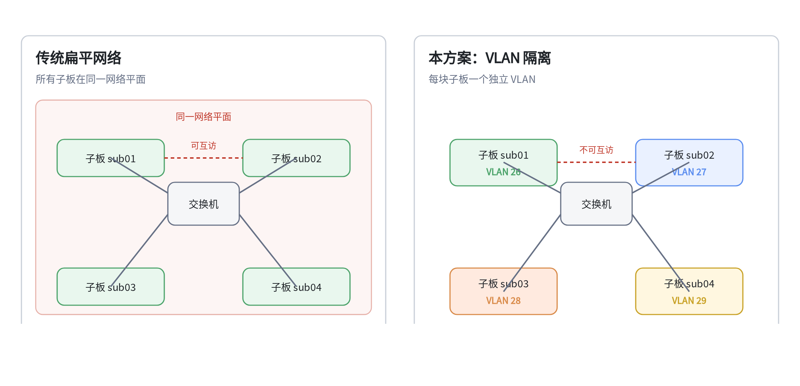

# 网络隔离案例

## 概述

本案例介绍如何利用服务器内部交换机的 VLAN 功能，实现子板（计算核心板）之间的二层网络隔离：子板之间互相不可见、无法直接通信，但每块子板仍能正常访问外部网络，并被 BMC 管理。

## 读者对象

- **网络管理员**：规划子板对应的 VLAN ID、交换机端口和 IP 地址。
- **多租户、研发测试环境的运维人员**：需要让不同子板互不可见、互不影响。
- **安全合规负责人**：需要避免子板互通带来的横向攻击和故障扩散风险。

## 应用场景

服务器内部通常有多块子板。默认情况下所有子板处于同一网络平面，任意一块子板都能直接访问其他子板；一旦某块子板被入侵或出现异常流量，风险会扩散到整个集群。

| 场景 | 子板之间是否需要互访 | 是否适用本方案 |
| --- | --- | --- |
| 多租户、算力租用 | 不允许互访 | 适用 |
| 研发、测试集群 | 按项目互相隔离 | 适用 |
| 单业务整机部署 | 需要互访 | 不适用，保持默认网络即可 |

## 方案原理

### VLAN 怎么划分

| VLAN | 用途 |
| --- | --- |
| VLAN 2–49 | 每块子板一个专属 VLAN，用于子板之间隔离 |
| VLAN 50 | 外部网络（子板访问外网、BMC 对外通信） |
| VLAN 4000 | BMC 与交换机之间的管理通信 |

每块子板对应一个唯一的 VLAN 编号，例如 sub3-01 使用 26、sub3-02 使用 27。VLAN 编号与交换机端口的对应关系需要按实际设备整理。

### 端口怎么配

| 端口 | 配置参数（示例） | 作用 |
| --- | --- | --- |
| 外部口 `xe1/49–xe1/52` | `default 50 utag 2-49` | 子板访问外网时移除 VLAN 标签 |
| BMC 口 `xe1/54` | `default 50 utag 2-49 tag 4000` | BMC 通过 VLAN 50 上网，保留 VLAN 4000 管理标签 |
| 子板口 `ge1/33` 等 | `default <子板 VLAN> utag 50` | 子板数据进入专属 VLAN；返回数据移除 VLAN 50 标签 |



*图：传统扁平网络（左）与 VLAN 隔离（右）对比；隔离后每块子板属于独立 VLAN，外部口移除子板 VLAN 标签，BMC 口保留管理 VLAN 标签。*

### 数据怎么走

以 sub3-01 为例：

1. sub3-01 发出的数据从 `ge1/33` 进入，被打上 **VLAN 26** 标签；
2. 访问外网时，数据从外部口发出，VLAN 2–49 标签被移除，以普通以太网帧发往外部网络；
3. 外部返回的数据从外部口进入，归入 **VLAN 50**，从 `ge1/33` 发给 sub3-01 时移除标签；
4. sub3-02 的数据使用 **VLAN 27**，与 VLAN 26 是两个独立的小网络，因此两块子板互相收不到对方的数据。

## 操作步骤

建议先规划、再配置交换机，最后配置子板，避免出现「VLAN 已建但端口未配置」的中间状态。

### 步骤 1：规划子板、端口和 VLAN[step]

按实际设备的「子板—交换机端口」对应关系，为每块子板确定：

| 项目 | 示例 | 说明 |
| --- | --- | --- |
| 子板 | sub3-01 | 以实际设备为准 |
| 交换机端口 | `ge1/33` | 以实际设备为准 |
| 专属 VLAN | 26 | 2–49，每块子板唯一 |
| 子板 IP | 172.16.11.87 | 仅作示例，按现场规划 |

### 步骤 2：在交换机上创建 VLAN[step]

登录交换机 Web 管理页面，创建并启用以下 VLAN：

| VLAN | 用途 |
| --- | --- |
| 50 | 外部通信网络 |
| 4000 | BMC 与交换机管理通信 |
| 2–49 | 每块子板一个（按实际子板数量创建） |

### 步骤 3：配置外部口[step]

将 `xe1/49`、`xe1/50`、`xe1/51`、`xe1/52` 设置为 **Hybrid** 模式，参数：

```text
default 50 utag 2-49
```

- `default 50`：外部进入的数据归入 VLAN 50；
- `utag 2-49`：子板数据从这里发出时移除 VLAN 标签，使外部网络能够正常识别。

### 步骤 4：配置 BMC 口[step]

将 BMC 使用的 `xe1/54` 设置为 **Hybrid** 模式，参数：

```text
default 50 utag 2-49 tag 4000
```

- `default 50`：BMC 通过 VLAN 50 访问外部网络；
- `utag 2-49`：与子板通信时移除 VLAN 标签；
- `tag 4000`：保留 VLAN 4000 标签，用于 BMC 与交换机的管理通信。

配置完成后，在 BMC 上执行 `ping 172.16.0.1`，能 ping 通外部网关即表示 BMC 网络正常。

### 步骤 5：配置子板口[step]

按规划将每块子板对应的端口设置为 **Hybrid** 模式，参数：

```text
default <该子板的 VLAN 编号> utag 50
```

示例：

| 子板 | 交换机端口 | 配置参数 |
| --- | --- | --- |
| sub3-01 | `ge1/33` | `default 26 utag 50` |
| sub3-02 | `ge1/29` | `default 27 utag 50` |

### 步骤 6：验证隔离效果[step]

| 测试项 | 操作方法 | 预期结果 |
| --- | --- | --- |
| 子板访问外网 | 在 sub3-01、sub3-02 上执行 `ping 172.16.0.1` | 能 ping 通 |
| BMC 访问子板 | 在 BMC 上执行 `ping -I nic0_5G 172.16.11.87` 和 `ping -I nic0_5G 172.16.10.44` | 能 ping 通 |
| 子板之间隔离 | 在 sub3-01 上 ping sub3-02 的 IP，再反向执行一次 | **ping 不通（正常现象）** |

<Callout title="注意" type="warn">
  子板之间 ping 不通是方案的设计目标，不是故障。文中的端口号、VLAN 编号和 IP 地址均为示例，请按现场设备和网络规划调整。
</Callout>