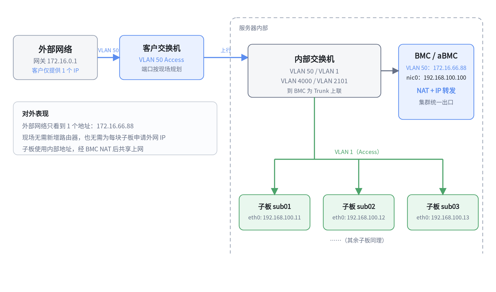
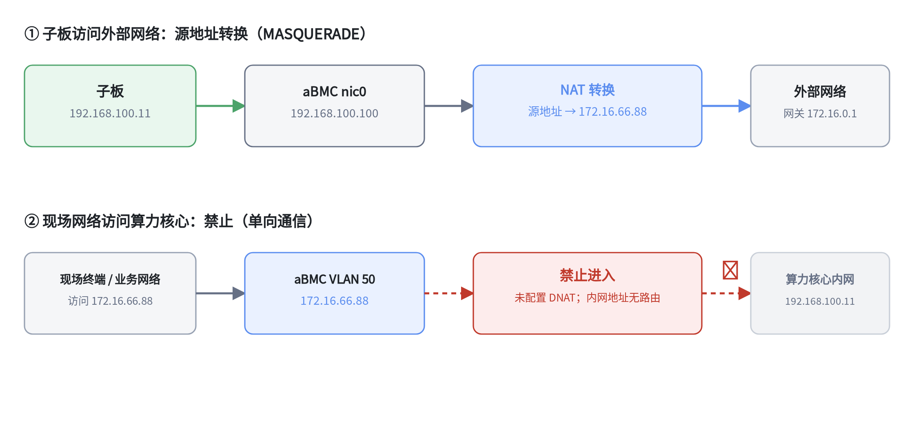

# 网络共享案例

## 概述

阵列式服务器规模化集群部署中，项目立项阶段往往无法确定现场具体网络环境，部署阶段才发现现场普遍存在外网 IP 配额有限、网络管控严格、禁止批量配置多个外网 IP 等刚性约束。

传统网络架构采用"单核心板、单外网 IP"的一对一组网模式，每块核心板都需要独立申请或手动配置外网 IP 才能接入网络。该模式只适合小规模设备部署；面对大节点阵列集群，会出现 IP 资源不足、多 IP 部署违规、运维成本高、地址浪费等问题。若新增路由器，不仅增加硬件采购和后续维护成本，还要经过多部门协调、预算审批和采购手续，显著延长部署周期。

本案例通过 BMC 的高速网卡（带宽建议不低于 5 Gbps）配合内部三层交换机，用 VLAN 虚拟出 WAN 口和 LAN 口，并在 BMC 上启用 NAT 和 IP 转发，让整个集群只占用一个外网 IP。目标是在不新增网络设备的前提下，降低外网 IP 消耗、简化运维、提高地址利用率，并实现内外网逻辑隔离。

## 读者对象

- **网络管理员、交付工程师**：现场外网 IP 配额有限，或禁止批量配置多个外网 IP。
- **运维人员**：希望减少逐台配置子板 IP 的工作量和维护成本。
- **项目负责人**：需要在不大规模改造现场网络的前提下完成集群部署。

## 应用场景

服务器集群节点数量持续增加时，传统一对一 IP 模式的局限性会集中暴露：

| 现场问题 | 具体表现 | 本案例的应对方式 |
| --- | --- | --- |
| 新增网络设备成本高、审批周期长 | 采购路由器增加硬件和管理维护成本；临时申报还要经过多部门协调、预算审批和采购手续 | 不新增路由器，复用 BMC 的 NAT 与 IP 转发能力 |
| 外网 IP 地址资源紧张 | `/24` 网段只有 254 个可用地址，两台 128 节点服务器就有 256 个节点 | 整个集群只占用一个外网 IP |
| 网络运维管理复杂 | 逐台配置、登记、维护 IP，批量配置容易产生 IP 冲突、参数错误和台账混乱 | 子板使用内部地址，只需配置 BMC 一个外网地址 |
| 外网 IP 资源利用率低 | 多数核心板只做常规数据交互，却各自占用一个外网 IP | 内部地址不占用外网 IP，外网地址集中复用 |

适合外网 IP 配额有限、禁止批量配置多个外网 IP、或不希望为组网新增路由器的集群部署。若现场外网 IP 充足，直接为每块子板配置独立 IP 即可，不需要启用本方案。

## 方案原理

### WAN / LAN 怎么划分

BMC 的高速网卡与内部三层交换机配合，通过 VLAN 虚拟出两路逻辑网口：

| 逻辑接口 | VLAN（示例） | 对接对象 | 作用 |
| --- | --- | --- | --- |
| WAN | VLAN 50 | 现场业务网络 | 集群统一的外网出口 |
| LAN | VLAN 1 | 算力核心（子板） | 承载算力核心的数据交互 |
| 管理 | VLAN 2101 / 4000 | aBMC、交换机 | 内部管理与设备通信 |

三层交换机把算力节点与现场业务网络划分为两个相互独立的网络区域，完成内外网隔离。

### 单向通信怎么实现

本案例要求**单向通信**：算力核心可以访问摄像头等现场终端设备，现场网络不能直接访问算力核心内网。

| 方向 | 是否允许 | 实现方式 |
| --- | --- | --- |
| 算力核心 → 现场终端 | 允许 | BMC 做 MASQUERADE（源地址转换） |
| 现场网络 → 算力核心内网 | 禁止 | 不配置 DNAT；内网地址不对外发布，依靠 VLAN 隔离和路由策略阻断 |



*图：外部网络只看到一个地址；算力核心使用内部地址接入，通过 BMC 的 NAT 共享外网 IP。*



*图：算力核心访问外网使用 MASQUERADE；现场网络访问算力核心内网未配置 DNAT，无法进入。*

### 数据怎么走

**算力核心访问现场终端：**

1. 子板把数据发给 BMC 的 nic0；
2. BMC 开启 IP 转发，把数据转到 WAN 口（VLAN 50）；
3. 经过 MASQUERADE，源地址变成 BMC 的 WAN 地址；
4. 数据以这个唯一的外网地址发往现场业务网络。

**现场网络访问算力核心：**

1. 现场终端访问 BMC 的 WAN 地址；
2. BMC 没有配置到算力核心内网的 DNAT 规则，也没有对应路由；
3. 数据无法进入算力核心内网。

## 操作步骤

建议按「交换机 VLAN → aBMC → 子板与路由 → IP 转发与 NAT → 验证」的顺序配置。

### 步骤 1：交换机配置 WAN / LAN VLAN[step]

登录交换机 Web 管理页面：

1. 创建 VLAN 50（WAN）、VLAN 1（LAN），以及管理用 VLAN 2101、4000；
2. 将现场业务网络接入口（示例 `ge1/25`、`ge1/26`、`xe1/27`、`xe1/28`）设置为 **Access** 并加入 VLAN 50；
3. 将 BMC 上联口（示例 `ge1/21`）设置为 **Trunk**，允许 VLAN 50 和 VLAN 4000 通过；
4. 将 BMC nic0 与各子板 eth0 对应的端口设置为 **Access** 并加入 VLAN 1（示例 `ge1/1`、`ge1/12`–`ge1/20`，BMC nic0 对应端口以实际设备为准）。

### 步骤 2：配置 aBMC[step]

1. 登录 aBMC 管理界面，打开「VLAN 网络配置」。
2. 添加 WAN 口（VLAN 50）：

    | 项目 | 配置值（示例） |
    | --- | --- |
    | IP 地址 | 172.16.66.88/16 |
    | 子网掩码 | 255.255.0.0（16 位） |
    | 网关 | 172.16.0.1 |
    | 网关优先级 | 100 |

3. 为 BMC 的 nic0（LAN 口）配置业务地址：192.168.100.100/24。
4. 在 aBMC 上执行 `ping 172.16.0.1`，能 ping 通表示 WAN 口配置正确。

### 步骤 3：配置子板与路由[step]

1. 为每块子板的 eth0 配置业务地址：

    ```text
    IP 地址：192.168.100.x/24（每块子板不同，且不要与 BMC 的 .100 冲突）
    ```

2. 为子板配置默认路由，指向 BMC 的 LAN 地址：

    ```bash
    ip route add default via 192.168.100.100
    ```

3. 在任意子板上执行 `ping 192.168.100.100`，能 ping 通 BMC 即表示 LAN 口配置正确。

### 步骤 4：开启 IP 转发并配置 NAT[step]

登录 BMC 系统：

```bash
# 开启 IP 转发
echo 1 > /proc/sys/net/ipv4/ip_forward

# 设置开机自动生效
echo "net.ipv4.ip_forward = 1" >> /etc/sysctl.conf
sysctl -p

# 如系统同时使用 nftables，先清空规则，避免冲突
nft flush ruleset

# 仅配置出方向：算力核心访问外网时做源地址转换
iptables-legacy -t nat -A POSTROUTING -o vlan50 -j MASQUERADE

# 查看规则
iptables-legacy -t nat -L -n -v
```

本案例不配置 DNAT，因此现场网络无法主动访问算力核心内网。

<Callout title="提示" type="info">
  如果 BMC 的 FORWARD 默认策略为 DROP，需要额外放行 LAN → WAN 的转发流量，否则子板仍无法访问外网。
</Callout>

### 步骤 5：验证单向通信[step]

| 测试项 | 操作方法 | 预期结果 |
| --- | --- | --- |
| 算力核心访问现场网络 | 在子板上执行 `ping 172.16.0.1` | 能 ping 通 |
| 算力核心访问公网 | 在子板上执行 `ping www.baidu.com` | 能 ping 通（子板需已配置 DNS） |
| 现场网络访问算力核心内网 | 在现场网络终端上 ping 子板内网地址（如 `192.168.100.11`） | **ping 不通（正常现象）** |

<Callout title="注意" type="warn">
  文中的地址、端口和 VLAN 编号均为示例，请按现场网络调整。BMC 重启后 `iptables` 规则和 `ip_forward` 默认不会自动恢复，需要做持久化配置。若业务确实需要外部访问子板，应另行评估安全风险并配置 DNAT，不要直接放开整个内网。
</Callout>