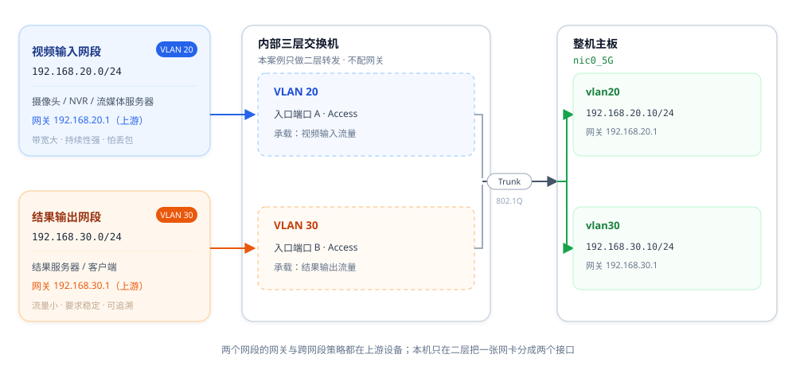

# 单网卡多网段案例

## 概述

本章介绍服务器借助内部三层交换机的 VLAN 划分功能，将一张网卡等效为两张物理网卡的方法。

## 读者对象

本案例面向以下人员：

- **网络管理员**：规划 VLAN ID、网段与网关，并在上游设备放行对应 VLAN。
- **需要为业务划分网段的开发与测试人员**：理解「一张网卡两个接口」的实现方式与限制。

## 应用场景

一块网卡需要同时承载两个方向的业务：

- **视频流输入**：摄像头、NVR 或流媒体服务器把多路视频推进来，带宽大、持续性强，对丢包和抖动敏感。
- **结果输出**：算法分析结果、告警和截图回传给结果服务器或客户端，流量小但要求稳定、可追溯。

这两个网段由外部网络提供，从内部三层交换机的其他端口接入：例如上联到两台上游交换机，或一条 Trunk 承载两个 VLAN。内部三层交换机在这里只做二层转发，把两个网段分别送进对应的 VLAN。

传统做法只能加网卡：一块网卡一个网段，隔离靠物理分离，网线、交换机端口、上游端口都随之翻倍。而整机主板上并没有第二张业务网卡可用，只能两种业务共用同一网段，隔离要求无从谈起。

**本方案不需要增加路由器**：两个网段的网关都在上游设备上，本机只要把 VLAN 正确透传到 `nic0_5G`，再用两个 VLAN 设备（802.1Q 子接口）分别接住这两个网段即可。

> **交换机侧把 `nic0_5G` 所连端口设为 Trunk，放行两个 VLAN，并把两个网段的入口端口分别划入对应 VLAN；aBMC 侧在 `nic0_5G` 上创建两个 VLAN 设备（如 `vlan20`、`vlan30`），各配一个上游网段内的地址，网关指向上游设备。**

在系统看来，这就是两个各有 IP 的接口，效果与「两张网卡分属两个网段」完全一致——视频流走一个接口，结果回传走另一个接口。

## 方案原理

一张网卡之所以能承载两个网段，靠的是二层隔离加两个子接口，全程不涉及本机三层转发：

| 层次 | 手段 | 作用 |
| --- | --- | --- |
| 二层 | 交换机各端口按 VLAN 划入不同广播域 | 两个网段在交换机内部二层互不可见 |
| 二层 | `nic0_5G` 所连端口设为 Trunk，放行两个 VLAN | 一张网卡同时收发两个网段的报文 |
| 二层 | `nic0_5G` 上创建两个 VLAN 设备（子接口） | 系统看到两个独立接口，各配一个网段地址 |
| 三层 | 网关指向上游设备，本机不配 VLAN 接口、不做路由 | 出网与跨网段访问交给上游网络 |

等价关系：

| 传统多网卡方案（两个网段） | 本方案（一张网卡两个网段） | 为什么可以等价 |
| --- | --- | --- |
| 网卡一 + 网线一 + 上游端口 A ← 网段 A | `vlan20`（VLAN Link = `nic0_5G`）+ VLAN 20 Tag | 报文 Tag 区分广播域，二层互不可见 |
| 网卡二 + 网线二 + 上游端口 B ← 网段 B | `vlan30`（VLAN Link = `nic0_5G`）+ VLAN 30 Tag | 同上，等价于第二个物理网络 |
| 两个网段各有一个上游网关 | 两个 VLAN 设备各填一个上游网关地址 | 网关仍在上游，本机只是把流量按 VLAN 分开送出去 |

整体拓扑如下：



*图：左侧两个网段分别从交换机的入口端口 A、B 进入 VLAN 20 / VLAN 30；中间交换机只做二层并汇合到 Trunk；右侧 `nic0_5G` 上一个 Trunk 口拆成 `vlan20`、`vlan30` 两个接口，网关仍指向上游。*

## 操作步骤

交换机与 BMC 两侧的 VLAN ID 必须一致，建议先配交换机、再配 BMC，避免出现「VLAN 已建但链路不通」的中间状态。

### 步骤 1：内部三层交换机侧[step]

进入 aBMC 管理页面，选择 **设备管理** → **交换机管理设置**，按下表完成 VLAN 与端口配置。

| 配置对象 | 取值 | 作用 |
| --- | --- | --- |
| VLAN | 创建 VLAN 20、VLAN 30 | 划分两个广播域 |
| 连接 `nic0_5G` 的端口 | **Trunk**，放行 VLAN 20、VLAN 30 | 让一张网卡同时承载两个网段 |
| 网段一入口端口 | Access，VLAN 20 | 把视频输入网段送进 VLAN 20 |
| 网段二入口端口 | Access，VLAN 30（同上） | 把结果输出网段送进 VLAN 30 |

### 步骤 2：BMC 侧创建 VLAN 设备[step]

进入 BMC 的 **System → Network → VLAN Manage**，在 `nic0_5G` 上新增两个 VLAN 设备，每个网段一个，参数如下：

| VLAN 设备 | VLAN ID | VLAN Link | IPv4 地址 | 网关 | 网关优先级 |
| --- | --- | --- | --- | --- | --- |
| `vlan20` | 20 | `nic0_5G` | 192.168.20.10/24 | 192.168.20.1 | 100 |
| `vlan30` | 30 | `nic0_5G` | 192.168.30.10/24 | 192.168.30.1 | 200 |

网关填写**上游设备**在该网段的地址。VLAN ID 与 VLAN Link 创建后不可更改，填错需删除重建；字段说明、页面截图与增删改限制见 [《aBMC Web 使用手册》](/docs/server/bmc-software/aBMC/bmcNetwork) 的「管理 BMC VLAN」一节。

### 步骤 3：验证连通性[step]

在 BMC 命令行分别 `ping` 两个网段的网关，确认每个 VLAN 设备都能到达所属网段：

```bash
ping -c 4 192.168.20.1   # vlan20 的网关
ping -c 4 192.168.30.1   # vlan30 的网关
```

| 接口 | 网关 | 预期结果 |
| --- | --- | --- |
| `vlan20` | 192.168.20.1 | 有回应，丢包率 0% |
| `vlan30` | 192.168.30.1 | 有回应，丢包率 0% |