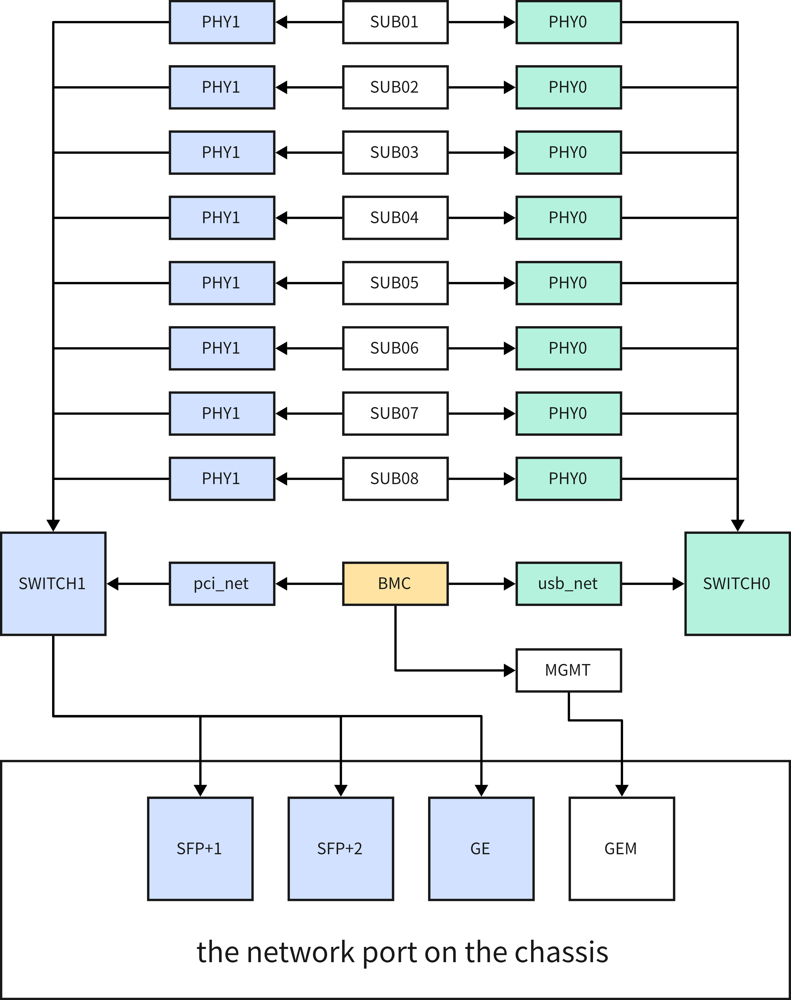
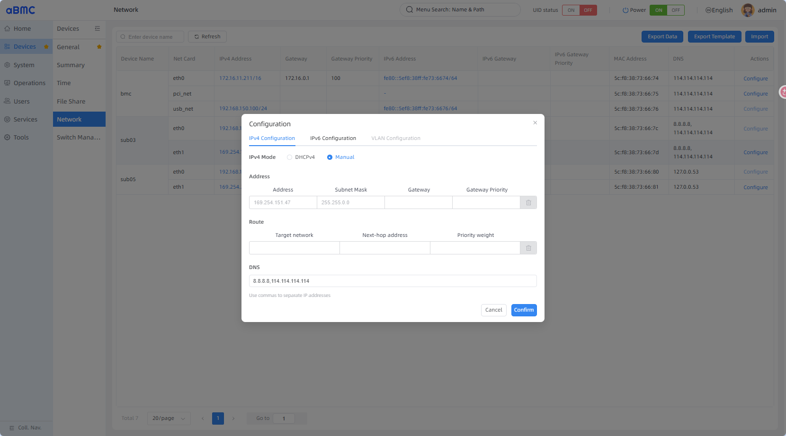
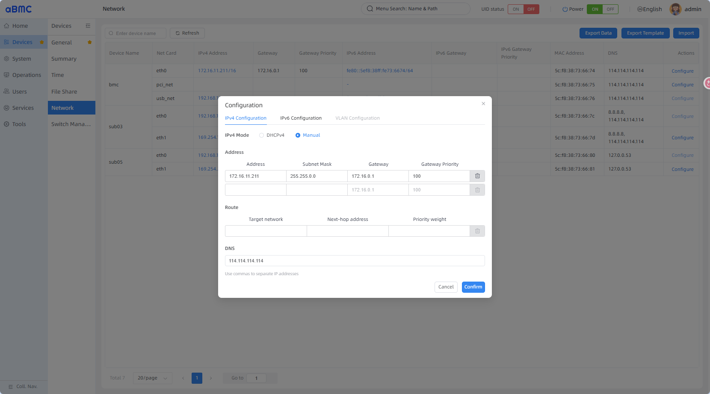

# 网络共享案例

## 概述

阵列式服务器规模化集群部署中，项目立项阶段往往无法确定现场具体网络环境，部署阶段才发现现场普遍存在外网 IP 配额有限、网络管控严格、禁止批量配置多个外网 IP 等刚性约束。

传统网络架构采用"单核心板、单外网 IP"的一对一组网模式，每块核心板都需要独立申请或手动配置外网 IP 才能接入网络。该模式只适合小规模设备部署；面对大节点阵列集群，会出现 IP 资源不足、多 IP 部署违规、运维成本高、地址浪费等问题。若新增路由器，不仅增加硬件采购和后续维护成本，还要经过多部门协调、预算审批和采购手续，显著延长部署周期。

本案例通过 BMC 的高速网卡（带宽建议不低于 5 Gbps）配合内部三层交换机，用 VLAN 虚拟出 WAN 口和 LAN 口，并在 BMC 上启用 NAT 和 IP 转发，让整个集群只占用一个外网 IP。目标是在不新增网络设备的前提下，降低外网 IP 消耗、简化运维、提高地址利用率，并实现内外网逻辑隔离。

## 读者对象

- **网络管理员、交付工程师**：现场外网 IP 配额有限，或禁止批量配置多个外网 IP。
- **运维人员**：希望减少逐台配置子板 IP 的工作量和维护成本。
- **项目负责人**：需要在不大规模改造现场网络的前提下完成集群部署。

## 应用场景

服务器集群节点数量持续增加时，传统一对一 IP 模式的局限性会集中暴露：

| 现场问题 | 具体表现 | 本案例的应对方式 |
| --- | --- | --- |
| 新增网络设备成本高、审批周期长 | 采购路由器增加硬件和管理维护成本；临时申报还要经过多部门协调、预算审批和采购手续 | 不新增路由器，复用 BMC 的 NAT 与 IP 转发能力 |
| 外网 IP 地址资源紧张 | 上架一台服务器，会占用十几个外网 IP | 整个集群只占用一个外网 IP |
| 网络运维管理复杂 | 逐台配置、登记、维护 IP，批量配置容易产生 IP 冲突、参数错误和台账混乱 | 子板使用内部地址，只需配置 BMC 一个外网地址 |
| 外网 IP 资源利用率低 | 多数核心板只做常规数据交互，却各自占用一个外网 IP | 内部地址不占用外网 IP，外网地址集中复用 |

适合外网 IP 配额有限、禁止批量配置多个外网 IP、或不希望为组网新增路由器的集群部署。若现场外网 IP 充足，直接为每块子板配置独立 IP 即可，不需要启用本方案。

## 网络拓扑图

CSA1-N8 单机的物理连接：一台机箱内 8 块子板（SUB01–SUB08），每块子板两侧各挂一颗 PHY 网卡，分别接入两颗内部交换机；BMC 通过 pci_net、usb_net 两路网卡分别挂在两颗交换机上；SFP+1、GE、SFP+2、GEM 是机箱面板上的对外网口。本方案的 VLAN 划分与 NAT 都基于这套物理链路。



*图：CSA1-N8 单机网络拓扑；本方案只使用 SWITCH0 一侧链路，SWITCH1 侧闲置。*

## 方案原理

将服务器的 PHY1 网卡全部关闭，数据按以下路径流动：

1. 现场网络从机箱上的 GE 口进入，到达 BMC 的 eth0 网卡（外网口）；
2. BMC 做 NAT 与 IP 转发，数据从 usb_net 网卡流出；
3. 经交换机 SWITCH0 到达子板的 eth0 网卡。

## 操作步骤

### 步骤 1：配置子板 eth1 IP 与 DNS [step]

子板选择手动模式，IP 地址留空，配置 DNS：



### 步骤 2：进入子板命令行，增加新的网络配置 [step]

```bash
linaro@bm1684:~$ sudo cat /etc/netplan/eth0_static_ip.yaml 
network:
        version: 2
        renderer: NetworkManager
        ethernets:
                eth0:
                        dhcp4: no
                        addresses: [192.168.150.23/24]
                        optional: yes
linaro@bm1684:~$ sudo cat /etc/netplan/default.yaml 
network:
  version: 2
  renderer: NetworkManager
  ethernets:
    eth0:
      dhcp4: false
      dhcp6: false
      addresses:
      - 192.168.150.23/24
      optional: true
      routes:
      - to: 0.0.0.0/0
        via: 192.168.150.100
        metric: 100
linaro@bm1684:~$ 
```

1. 新建配置文件 `/etc/netplan/default.yaml`，路由填写 `192.168.150.100`，该地址是 BMC 的 usb_net 网卡的 IP；
2. eth0 的地址按 `/etc/netplan/eth0_static_ip.yaml` 中的地址填写；
3. 执行 `sudo netplan apply` 应用配置；
4. 执行 `ip a` 和 `route -n` 检查结果，关键看 eth0 拿到 `192.168.150.23/24`、路由表 `0.0.0.0` 条目的网关为 `192.168.150.100`。

```bash
linaro@bm1684:~$ ip a
1: lo: <LOOPBACK,UP,LOWER_UP> mtu 65536 qdisc noqueue state UNKNOWN group default qlen 1000
    link/loopback 00:00:00:00:00:00 brd 00:00:00:00:00:00
    inet 127.0.0.1/8 scope host lo
       valid_lft forever preferred_lft forever
    inet6 ::1/128 scope host
       valid_lft forever preferred_lft forever
    ...（dummy0、sit0 等无关接口略）
4: eth0: <BROADCAST,MULTICAST,UP,LOWER_UP> mtu 1500 qdisc mq state UP group default qlen 1000
    link/ether 5c:f8:38:73:66:7c brd ff:ff:ff:ff:ff:ff
    inet 192.168.150.23/24 brd 192.168.150.255 scope global noprefixroute eth0
       valid_lft forever preferred_lft forever
    inet6 fe80::5ef8:38ff:fe73:667c/64 scope link 
       valid_lft forever preferred_lft forever
5: eth1: <BROADCAST,MULTICAST,UP,LOWER_UP> mtu 1500 qdisc mq state UP group default qlen 1000
    link/ether 5c:f8:38:73:66:7d brd ff:ff:ff:ff:ff:ff
    inet 169.254.151.47/16 brd 169.254.255.255 scope link noprefixroute eth1
       valid_lft forever preferred_lft forever
    inet6 fe80::5ef8:38ff:fe73:667d/64 scope link noprefixroute
       valid_lft forever preferred_lft forever
    ...（docker0 略）
linaro@bm1684:~$ route -n
Kernel IP routing table
Destination     Gateway         Genmask         Flags Metric Ref    Use Iface
0.0.0.0         192.168.150.100 0.0.0.0         UG    100    0        0 eth0
169.254.0.0     0.0.0.0         255.255.0.0     U     101    0        0 eth1
172.17.0.0      0.0.0.0         255.255.0.0     U     0      0        0 docker0
192.168.150.0   0.0.0.0         255.255.255.0   U     100    0        0 eth0
224.0.0.0       0.0.0.0         240.0.0.0       U     101    0        0 eth1
linaro@bm1684:~$ 
```

eth1 上有一个 169.254.x.x 网段的 IP，无需处理。
确认路由表中第一条的网关为 192.168.150.100 即可。

### 步骤 3：配置 BMC 的 eth0 网卡 [step]



<Callout title="必须使用静态 IP" type="warn">
  后续 NAT 规则依赖这个地址；如果使用 DHCP 动态分配地址，NAT 规则不会生效。
</Callout>

### 步骤 4：配置 BMC 的 NAT 和 IP 转发 [step]

登录 BMC 系统：

```bash
# 开启 IP 转发
echo 1 > /proc/sys/net/ipv4/ip_forward

# 设置开机自动生效
echo "net.ipv4.ip_forward = 1" >> /etc/sysctl.conf
sysctl -p

# 配置 NAT 规则
iptables-legacy -t nat -A PREROUTING -i eth0 ! -d 172.16.11.211 -j DNAT --to-destination 192.168.150.1-192.168.150.200

# 仅配置出方向：算力核心访问外网时做源地址转换 
iptables-legacy -t nat -A POSTROUTING -o eth0 -j MASQUERADE

# 查看规则
iptables-legacy -t nat -L -n -v
```

#### NAT 规则持久化

上面的 iptables 规则只存在于内存中，设备重启后失效。用 systemd 服务在开机时自动下发这两条规则。

1. 新建服务单元 `/etc/systemd/system/nat-forward.service`：

```bash
cat > /etc/systemd/system/nat-forward.service <<'EOF'
[Unit]
Description=Persist NAT forwarding rules
After=network-online.target
Wants=network-online.target

[Service]
Type=oneshot
RemainAfterExit=yes
ExecStart=/usr/sbin/iptables-legacy -t nat -A PREROUTING -i eth0 ! -d 172.16.11.211 -j DNAT --to-destination 192.168.150.1-192.168.150.200
ExecStart=/usr/sbin/iptables-legacy -t nat -A POSTROUTING -o eth0 -j MASQUERADE

[Install]
WantedBy=multi-user.target
EOF
```

2. 启用服务并立即启动：

```bash
systemctl daemon-reload
systemctl enable nat-forward.service
systemctl start nat-forward.service
```

3. 验证服务状态和规则：

```bash
systemctl status nat-forward.service --no-pager
iptables-legacy -t nat -L -n -v
```

预期 `systemctl status` 显示 `active (exited)`，`iptables-legacy -t nat -L -n -v` 中能看到 DNAT 和 MASQUERADE 两条规则。之后设备每次重启都会自动下发。

<Callout title="注意" type="warn">
  服务每启动一次就追加一次规则，反复 `systemctl restart` 会出现重复条目，需要清理时重启设备；本服务只负责 iptables 规则，`ip_forward` 已由前面的 `/etc/sysctl.conf` 配置持久化；BMC 的 eth0 必须保持静态 IP（见步骤 3），修改 eth0 地址后需同步修改本服务里的地址并执行 `systemctl restart nat-forward.service`。
</Callout>

### 步骤 5：验证单向通信 [step]

| 测试项 | 操作方法 | 预期结果 |
| --- | --- | --- |
| 算力核心访问现场网络 | 在子板上执行 `ping 172.16.0.1` | 能 ping 通 |
| 算力核心访问公网 | 在子板上执行 `ping www.baidu.com` | 能 ping 通（子板需已配置 DNS） |
| 现场网络访问算力核心内网 | 在现场网络终端上 ping 子板内网地址（如 `192.168.150.21`） | **ping 不通（正常现象）** |
