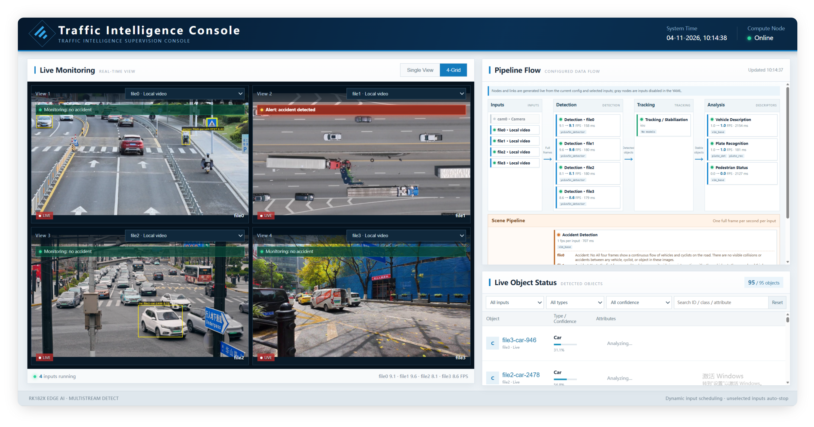
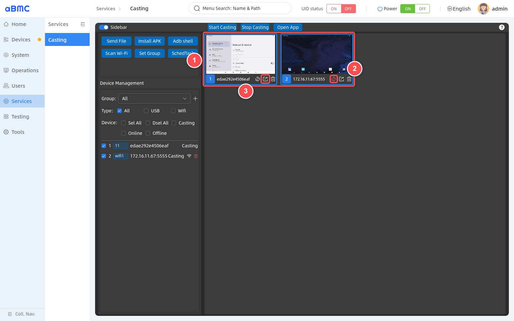

# 快速开始

如果您是第一次使用 CSB1-N10 服务器，建议按以下顺序了解和使用本产品，从产品认知、开机验证到开发对接与现场交付，逐步完成上手。

本产品是一款阵列式（多个SOC通过USB和网络的方式组合在一起）服务器，解决的实际问题是解决单一计算单元计算能力不足的问题，同时整机价格相比同等算力的X86服务器有优势。为了方便客户操作和开发，我们在BMC上开发了aBMC服务程序，主要提供网络远程刷机、网络设置和设备状态监控等功能。那相比于多个计算盒子组织网，我们这的阵列式服务器有什么优势？

| 项目 | 说明 |
| :--- | :--- |
| 成本 | 标准服务器 > 阵列式服务器 > 同等算力算力盒子 |
| 管理便捷性 | 依托 aBMC 实现远程刷机、网络配置、状态监控，远程运维便捷 |
| 性能 | 机架式具备更强的供电与散热能力，相比算力盒子稳定性更好 |
| 部署交付 | 算力节点整机集成，适配机房机柜，方便现场部署、验收 |

目前服务器常用的用户场景有以下几种

<CodeBlockTabs defaultValue="edge-AI-infer">
    <CodeBlockTabsList>
        <CodeBlockTabsTrigger value="edge-AI-infer">AI边缘推理</CodeBlockTabsTrigger>
        <CodeBlockTabsTrigger value="transcode">编码转码</CodeBlockTabsTrigger>
        <CodeBlockTabsTrigger value="cloud-phone">云手机</CodeBlockTabsTrigger>
        <CodeBlockTabsTrigger value="RISC-V">RISC-V</CodeBlockTabsTrigger>
    </CodeBlockTabsList>

    <CodeBlockTab value="transcode">
    编码转码场景通常使用RK3588/RK3588S
    | SOC | 厂家 | 编/转码视频流数量（参考） |
    | :---: | :---: | :---: |
    | RK3588/RK3588S | Rockchip | 16 |

    用户可以使用rkmpp或者ffmedia编解码去快速实现项目
    1. rkmpp：Rockchip 官方底层媒体 SDK，直接操作 VPU 硬件，自由度高、可控性强，适合需要深度定制媒体链路的自研项目
    2. ffmedia: Firefly 封装的上层媒体管线框架，内置 RKMPP/RGA/RKNN 联动，模块可快速拼装，上手快，适合快速落地原型与业务
    </CodeBlockTab>

    <CodeBlockTab value="edge-AI-infer">

    | SOC | 厂家 | AI推理视频流数量（参考） |
    | :---: | :---: | :---: |
    | RK3588/RK3588S | Rockchip | 4 |
    | BM1684X | Sophgo | 16 |
    | Jetson Orin NX 16GB | NVIDIA | 10 |
    | Jetson Orin Nano 8GB | NVIDIA | 6 |

    

    </CodeBlockTab>

    <CodeBlockTab value="cloud-phone">
    云手机场景推荐使用RK3588/RK3588S，基于容器化技术实现云手机多开。
    支持功能如下：
    <Cards>
        <Card title="批量同屏">
          多设备画面同步同屏展示。
        </Card>
        <Card title="自动Root">
          自动化完成设备Root权限配置。
        </Card>
        <Card title="GPS定位">
          模拟/读取GPS位置信息。
        </Card>
        <Card title="陀螺仪">
          陀螺仪传感器数据模拟与上报。
        </Card>
        <Card title="手机选型">
          云手机硬件方案、SoC选型对比。
        </Card>
        <Card title="一键新机">
          一键重置设备环境，生成全新设备标识。
        </Card>
        <Card title="远程重启/关机">
          远程对手机节点执行重启、关机操作。
        </Card>
        <Card title="APK 管理">
          APK 批量安装、卸载。
        </Card>
        <Card title="恢复出厂设置">
          远程触发设备恢复出厂。
        </Card>
        <Card title="数据备份">
          设备应用与数据批量备份。
        </Card>
    </Cards>

    
    </CodeBlockTab>

    <CodeBlockTab value="RISC-V">
    服务器支持安装 Spacemit K3 ，用户可以
    </CodeBlockTab>
</CodeBlockTabs>

如果您是第一次使用 CSB1-N10 服务器，建议按以下顺序了解和使用本产品，从产品认知、开机验证到开发对接与现场交付，逐步完成上手。
1. 产品规格介绍
2. 服务器开机测试
3. 服务器相关SDK和API开发资料获取
4. 服务器固件计算节点固件
5. 现场交付

<Callout title="上电前先看：安全规范" type="warn">
  严禁带电插拔电源线；断电后等待 30 秒以上再上电。不同机型的上电方式不同，请先阅读对应机型的[电源操作](start-server-power)。
</Callout>

<CodeBlockTabs defaultValue="tasks">
    <CodeBlockTabsList>
        <CodeBlockTabsTrigger value="tasks">按任务查找</CodeBlockTabsTrigger>
        <CodeBlockTabsTrigger value="first">第一次使用</CodeBlockTabsTrigger>
    </CodeBlockTabsList>

    <CodeBlockTab value="tasks">
      <Cards>
        <Card title="安装与上电" href="start-server-installation">
          服务器安装、电源规范、上电与状态检查。
        </Card>
        <Card title="网络与登录" href="start-server-network">
          BMC IP、子板网络，以及 Web / SSH / 串口登录。
        </Card>
        <Card title="aBMC 功能" href="aBMC">
          用户、告警、存储、电源策略等常用管理功能。
        </Card>
        <Card title="应用案例" href="application-cases">
          单网卡多网段、网络隔离、网络共享等案例。
        </Card>
        <Card title="固件与定制" href="bmc-firmware-upgrade">
          BMC 升级、定制固件与 recovery；SDK 与系统支持见「获取 SDK 与系统支持」。
        </Card>
        <Card title="运维与排障" href="op-issues-troubleshooting">
          日志收集、异常排查、子板断联处理。
        </Card>
      </Cards>
    </CodeBlockTab>

    <CodeBlockTab value="first">
      | **准备** | **联网** | **使用** | **交付** |
      | :---: | :---: | :---: | :---: |
      | 1–4 | 5–6 | 7–8 | 9 |

      ### 准备 · 确认规格与支持 [step]

      确认节点数量、接口、功耗，以及本机型支持的操作系统和子板型号。

      - [规格和组件](product-specifications)
      - [系统支持列表](sdk-application#系统支持列表)

      ### 开箱与配件确认 [step]

      核对电源线、滑轨 / 支架、SFP 模块、串口线等配件，具体以机型配件清单为准。

      ### 上电规范 [step]

      确认供电、接地和上电顺序，严禁带电插拔电源线；断电后等待 30 秒以上再上电。

      - [电源操作](start-server-power)

      ### 上电、开机与状态检查 [step]

      接入电源，检查节点 / 系统指示灯和 BMC 指示灯，确认设备进入可管理状态。

      - [状态识别](start-server-status)

      ### 联网 · 网络接线与访问 BMC [step]

      按现场方式接好管理网络，用默认 IP 或 DHCP 地址访问 BMC，完成首次登录。

      - [网络接线方式](start-server-network)
      - [访问 BMC](start-login-bmc)

      ### 配置 aBMC 网络与子板 [step]

      登录后再修改 BMC 的 IP / VLAN，确认管理网络符合现场规划，然后登录子板。

      - [aBMC 网络配置](/docs/server/bmc-software/aBMC/bmcNetwork)
      - [子节点登录](start-login-sub)
      - [串口使用](start-server-serial)

      ### 使用 · aBMC 功能与方案 [step]

      配置用户、告警、存储、电源策略等常用功能，按现场需求选择网络方案。

      - [aBMC 使用手册](/docs/server/bmc-software/aBMC/preface)
      - [应用案例](application-cases)

      ### SDK、固件与定制 [step]

      在「获取 SDK 与系统支持」页面查看系统支持列表并获取 SDK；按需升级 BMC 或定制固件。

      - [获取 SDK 与系统支持](sdk-application)
      - [定制固件](dev-sub-firmware)
      - [BMC 升级](bmc-firmware-upgrade)

      ### 交付 · 现场部署与上架安装 [step]

      完成上架、接线和上电。客户部署自己的业务软件，验收标准由客户自行确定。

      - [服务器安装](start-server-installation)
      - [电源操作](start-server-power)
    </CodeBlockTab>
</CodeBlockTabs>

## 下载与支持

<Cards>
  <Card title="下载与支持" href="/docs/server/bmc-software/aBMC/install">
    获取 aBMC 安装包，查看版本目录与安装命令。
  </Card>
  <Card title="获取 SDK 与系统支持" href="sdk-application#系统支持列表">
    查看系统支持列表并获取 SDK。
  </Card>
  <Card title="更新记录" href="release-notes">
    查看 aBMC 与 Wiki 的最新变更。
  </Card>
</Cards>